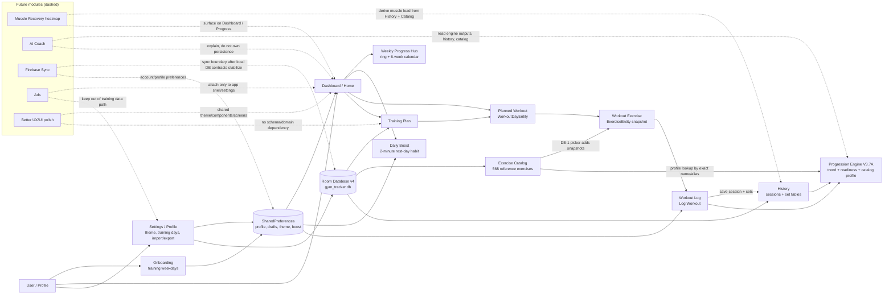

```mermaid
flowchart TB
    subgraph Entry["App entry and dependency creation"]
        MainActivity["MainActivity\nedge-to-edge Compose host"]
        Application["GymTrackerApplication\ncreates DB + repositories"]
        Factory["AppViewModelFactory\nmanual VM injection"]
    end

    subgraph Navigation["Navigation graph"]
        AppShell["GymTrackerApp\nNavHost + onboarding gate + bottom dock"]
        HomeRoute["home"]
        PlanRoute["plan"]
        HistoryRoute["history"]
        SettingsRoute["settings"]
        DetailRoute["detail/{dayId}"]
        LogRoute["log/{dayId}"]
        ExerciseRoute["exercise/{exerciseId}"]
        CatalogRoute["catalog/{dayId}"]
    end

    subgraph Screens["Screens / Composables"]
        OnboardingScreen["OnboardingScreen"]
        HomeScreen["HomeScreen"]
        WeeklySheet["WeeklyProgressHubSheet"]
        DailyBoostUi["DailyBoostSection"]
        PlanScreen["PlanScreen"]
        CatalogScreen["CatalogPickerScreen"]
        CatalogDetailSheet["CatalogExerciseDetailSheet\nCatalogDetailHost"]
        WorkoutDetailScreen["WorkoutDetailScreen"]
        LogScreen["LogWorkoutScreen"]
        HistoryScreen["HistoryScreen"]
        ExerciseDetailScreen["ExerciseDetailScreen"]
        SettingsScreen["SettingsScreen\nAI Import Helper"]
        Components["Shared UI components\ntheme, cards, sheets, thumbnails"]
    end

    subgraph State["ViewModels and UI state"]
        OnboardingVm["OnboardingViewModel\nOnboardingUiState"]
        HomeVm["HomeViewModel\nHomeUiState, WeeklyHubUiState, DailyBoostUiState"]
        PlanVm["PlanViewModel\nplan StateFlow"]
        CatalogVm["CatalogPickerViewModel\nCatalogPickerUiState"]
        DetailVm["WorkoutDetailViewModel\nWorkoutDetailUiState"]
        LogVm["LogWorkoutViewModel\nLogWorkoutUiState + events"]
        HistoryVm["HistoryViewModel\nHistoryUiState"]
        ExerciseVm["ExerciseDetailViewModel\nExerciseDetailUiState"]
        SettingsVm["SettingsViewModel\nSettingsUiState"]
    end

    subgraph Domain["Use cases / engines"]
        Progression["Progression Engine V3.7A\nProgressiveOverloadEngine"]
        BoostCatalog["DailyBoostExercise enum"]
        SeedPlan["SeedData default split"]
        PlanNameMigration["PlanNameMigration\nFED-canonical active plan names"]
        ImportExport["Local JSON import/export\nGymRepository"]
    end

    subgraph Data["Repositories and storage"]
        GymRepo["GymRepository\nplan, save, history, PR, import/export"]
        PrefRepo["UserPreferencesRepository\ntheme, onboarding, selected day, boost"]
        DraftRepo["WorkoutDraftRepository\nper-day draft JSON"]
        CatalogRepo["ExerciseCatalogRepository\nseed/search/find/detail/thumbnails"]
        Database["AppDatabase Room v4\nMIGRATION_1_2, 2_3, 3_4"]
        GymDao["GymDao"]
        CatalogDao["CatalogDao"]
        Entities["Entities\nWorkoutDay, Exercise, WorkoutSession, LoggedSet"]
        CatalogEntity["CatalogExerciseEntity\ncatalog_exercises"]
        CatalogAsset["assets/catalog/catalog_fed_v1.json\n568 exercises"]
        CatalogLoader["CatalogJsonLoader\nCatalogSearch\nCatalogThumbnailLookup"]
        PrefStore[("SharedPreferences")]
        RoomStore[("SQLite Room DB")]
    end

    subgraph Tests["Tests"]
        EngineTests["ProgressiveOverloadEngineTest\n70 engine cases incl V3.7A"]
        CatalogTests["CatalogSearchTest\n568 catalog, images, migration map"]
        ThumbnailTests["CatalogThumbnailLookupTest"]
        ReadinessTests["ReadinessTest"]
        Schemas["Room schema JSON\nversions 2, 3, 4"]
    end

    subgraph FutureBoundary["Future integration boundaries (dashed)"]
        RecoveryBoundary["Muscle Recovery module\nread-only aggregate first"]
        AiBoundary["AI Coach boundary\nprovider adapter + DTOs"]
        FirebaseBoundary["Firebase sync boundary\naccounts, remote DTOs, conflict policy"]
    end

    MainActivity --> AppShell
    Application --> Database
    Application --> GymRepo
    Application --> PrefRepo
    Application --> DraftRepo
    Application --> CatalogRepo
    Application --> PlanNameMigration
    Factory --> OnboardingVm
    Factory --> HomeVm
    Factory --> PlanVm
    Factory --> CatalogVm
    Factory --> DetailVm
    Factory --> LogVm
    Factory --> HistoryVm
    Factory --> ExerciseVm
    Factory --> SettingsVm

    AppShell --> HomeRoute
    AppShell --> PlanRoute
    AppShell --> HistoryRoute
    AppShell --> SettingsRoute
    HomeRoute --> DetailRoute
    DetailRoute --> LogRoute
    PlanRoute --> CatalogRoute
    PlanRoute --> ExerciseRoute
    AppShell --> OnboardingScreen

    HomeRoute --> HomeScreen
    PlanRoute --> PlanScreen
    HistoryRoute --> HistoryScreen
    SettingsRoute --> SettingsScreen
    DetailRoute --> WorkoutDetailScreen
    LogRoute --> LogScreen
    ExerciseRoute --> ExerciseDetailScreen
    CatalogRoute --> CatalogScreen

    OnboardingScreen --> OnboardingVm
    HomeScreen --> HomeVm
    HomeScreen --> WeeklySheet
    HomeScreen --> DailyBoostUi
    PlanScreen --> PlanVm
    CatalogScreen --> CatalogVm
    WorkoutDetailScreen --> DetailVm
    LogScreen --> LogVm
    HistoryScreen --> HistoryVm
    ExerciseDetailScreen --> ExerciseVm
    SettingsScreen --> SettingsVm
    PlanScreen --> CatalogDetailSheet
    LogScreen --> CatalogDetailSheet
    HistoryScreen --> CatalogDetailSheet
    WorkoutDetailScreen --> CatalogDetailSheet
    Components --> Screens

    OnboardingVm --> GymRepo
    OnboardingVm --> PrefRepo
    HomeVm --> GymRepo
    HomeVm --> PrefRepo
    PlanVm --> GymRepo
    CatalogVm --> CatalogRepo
    CatalogVm --> GymRepo
    DetailVm --> GymRepo
    LogVm --> GymRepo
    LogVm --> DraftRepo
    LogVm --> PrefRepo
    LogVm --> CatalogRepo
    HistoryVm --> GymRepo
    ExerciseVm --> GymRepo
    ExerciseVm --> CatalogRepo
    SettingsVm --> GymRepo
    SettingsVm --> PrefRepo

    LogVm --> Progression
    ExerciseVm --> Progression
    HomeVm --> BoostCatalog
    GymRepo --> SeedPlan
    GymRepo --> ImportExport
    PlanNameMigration --> GymDao

    GymRepo --> GymDao
    CatalogRepo --> CatalogDao
    CatalogRepo --> CatalogLoader
    CatalogLoader --> CatalogAsset
    PrefRepo --> PrefStore
    DraftRepo --> PrefStore
    Database --> GymDao
    Database --> CatalogDao
    Database --> Entities
    Database --> CatalogEntity
    GymDao --> RoomStore
    CatalogDao --> RoomStore

    EngineTests --> Progression
    CatalogTests --> CatalogLoader
    CatalogTests --> PlanNameMigration
    ThumbnailTests --> CatalogLoader
    ReadinessTests --> ImportExport
    Schemas --> Database

    RecoveryBoundary -. "read SessionWithSets + Catalog muscles" .-> GymRepo
    RecoveryBoundary -. "optional future cache/table" .-> Database
    AiBoundary -. "consume Progression, History, Catalog DTOs" .-> Progression
    AiBoundary -. "no direct DB writes" .-> GymRepo
    FirebaseBoundary -. "sync local entities after stable contracts" .-> RoomStore
    FirebaseBoundary -. "account prefs/profile" .-> PrefStore
```

# AURON Architecture Audit

Scope: read-only architecture audit of `D:\HOCTIN\GYM TRACKER`. No source files, database schema files, or app logic were modified. New artifacts are limited to `docs/architecture/`.

## Marker Check

- Present: AURON branding in `strings.xml`, Home, onboarding, and README.
- Present with drift: OLED dark theme is active, but the old dotted texture is no longer drawn by `Theme.kt`; `auron_dark_texture.png` is still retained as an asset. Current live theme is flat OLED dark-gray surfaces with card depth.
- Present: Weekly Progress Hub (`HomeViewModel`, `WeeklyProgressHubSheet`).
- Present: Daily Boost (`DailyBoostExercise`, `DailyBoostSection`, `UserPreferencesRepository`).
- Present: Progression Engine V3.7A (`ProgressiveOverload.kt`) with long-term trend intelligence.
- Present but superseded: the old "33 V3 tests" marker is carried forward into a larger current suite. `ProgressiveOverloadEngineTest.kt` now contains 70 engine tests, including V3.7A cases.
- Present: DB-0 catalog Room table (`catalog_exercises`) and Room schema v4.
- Present: DB-1 Catalog Picker (`CatalogPickerScreen`, `CatalogPickerViewModel`).
- Present: DB-1.5 detail popup (`CatalogExerciseDetailSheet`).
- Present: DB-1.6 popup wired into Log/History/View Detail through `CatalogDetailHost` and `openByName`.
- Present but evolved: current catalog seed is now JSON-backed FED-canonical content with 568 exercises and `CONTENT_VERSION = 14`, while preserving explicit AURON catalog contracts.
- Not present: Firebase/account/sync implementation. No Firebase, Google services, auth, or ads dependencies were found.

## Diagram 1 - AURON App Current Architecture Map

Files:

- `auron-current-architecture-map.mmd`
- `auron-current-architecture-map.svg`
- `auron-current-architecture-map.png`

Mermaid source:

Short explanation:

- The app is local-first: Room stores plan, catalog, sessions, and logged sets; SharedPreferences stores profile-like settings, onboarding, selected day, drafts, and Daily Boost state.
- Plan exercises are user-editable snapshots. Catalog items are reference entries and only become plan exercises through the picker.
- The progression engine is domain logic fed by recent history, catalog metadata, and readiness; it does not own persistence.
- Weekly Progress Hub and Daily Boost are Home-attached features, but Daily Boost deliberately does not write History or Weekly Progress.
- Future modules should attach through read-only domain/data boundaries first, not through screen-to-screen shortcuts.

Risky coupling:

- Catalog detail, thumbnails, and engine profiles rely on exact name/alias lookup. Renames can silently lose metadata unless the migration/map contract is maintained.
- `GymRepository` owns broad responsibilities: plan CRUD, session saving, PR marking, import/export, and seed behavior.
- SharedPreferences currently mixes onboarding/profile state, selected workout state, Daily Boost state, and drafts; this will complicate future account sync.
- Current theme docs are historically inconsistent: README still references OLED/dotted texture, while live `Theme.kt` uses a flat OLED background.

Future feature attachment:

- Muscle Recovery: add a domain module that derives muscle load from `SessionWithSets` plus catalog muscle metadata; surface it from Home or a future Progress tab.
- AI Coach: consume DTOs from history, catalog, and `ProgressiveOverloadEngine`; keep provider/network code behind an adapter and never write directly to Room.
- Firebase accounts/sync: add a sync boundary below repositories with remote DTOs, conflict policy, and account identity; keep local-first Room as source of truth.
- Ads: attach to app shell/top-level UI and Settings only; keep out of Log Workout, engine, Room, and catalog.
- Onboarding: extend the existing onboarding/preferences boundary; avoid baking profile setup into Home or Settings composables.
- UX/UI polish: keep changes in `ui/theme` and `ui/components`; do not couple visual polish to data/domain code.

## Diagram 2 - AURON Technical Architecture Deep Map

Files:

- `auron-technical-architecture-deep-map.mmd`
- `auron-technical-architecture-deep-map.svg`
- `auron-technical-architecture-deep-map.png`

Mermaid source:

Short explanation:

- `GymTrackerApplication` manually creates the Room database and repositories; `GymTrackerApp` wires ViewModels with `AppViewModelFactory`.
- `GymTrackerApp` owns the route graph and the onboarding gate before the NavHost.
- ViewModels expose StateFlow UI state; composables render prepared state and mostly delegate persistence to ViewModels.
- `GymRepository` is the main user-data repository; `ExerciseCatalogRepository` is the catalog reference repository; preferences/drafts stay outside Room.
- `ProgressiveOverloadEngine` is a pure-ish domain object tested by JVM tests and fed by Log/Exercise detail ViewModels.
- Tests cover the engine, catalog JSON/search/images/name migration, thumbnail lookup, readiness parsing, and exported Room schema snapshots.

Risky coupling:

- `LogWorkoutViewModel` is the heaviest crossroad: draft persistence, save flow, auto-advance, recent history, catalog profiles, readiness, and engine calls all meet there.
- `ProgressiveOverload.kt` is large and internally dense. It is well-tested, but future coach logic should not keep expanding the same file indefinitely.
- Catalog comments in `CatalogDao` still say "small, ~150-max" even though the live catalog has 568 exercises.
- `CatalogDetailHost` is a reusable UI controller, but it is opened by name from several screens; this makes exact catalog naming a system contract.
- Import/export uses repository-level JSON with schemaVersion 1 and optional readiness. Future sync should not reuse that JSON as the remote protocol without a versioned DTO layer.

## Current App State Summary

- Android app: Kotlin, Jetpack Compose, Material 3, Navigation Compose, Room, SharedPreferences, MVVM-style ViewModels.
- User-facing product: AURON. Internal package, app id, Room name, and class names remain `com.hoctin.gymtracker` / `gym_tracker.db`.
- Local-first: no backend, login, Firebase, ads, billing, or network sync implementation found.
- Room database version: 4.
- Catalog: 568 JSON-backed reference exercises in `assets/catalog/catalog_fed_v1.json`, seeded to `catalog_exercises`.
- Progression Engine: V3.7A runtime-only trend overlay, V3.6 readiness confidence/wording, V3.5 catalog profile support.
- Tests: 70 engine tests, 25 catalog search/seed/migration tests, 2 thumbnail tests, 5 readiness tests.

## Folder / Package Map

- `app/src/main/java/com/hoctin/gymtracker`: `MainActivity`, `GymTrackerApplication`.
- `data`: Room entities, DAO, database, main repository, preferences, drafts, readiness, seed split.
- `data/catalog`: catalog domain model, Room entity/DAO, JSON loader, search, taxonomy, repository, thumbnail lookup, plan-name migration.
- `domain`: `ProgressiveOverloadEngine` and `DailyBoostExercise`.
- `ui`: app shell/navigation, shared formatting, ViewModel factory.
- `ui/home`: Home, Weekly Progress Hub, Daily Boost, Home ViewModel.
- `ui/log`: Log Workout screen and ViewModel.
- `ui/history`: weekly grouped History screen and ViewModel.
- `ui/plan`: Training Plan screen and ViewModel.
- `ui/catalog`: Catalog Picker and reusable detail popup.
- `ui/detail`: workout-day detail screen before logging.
- `ui/exercise`: exercise history/detail screen.
- `ui/onboarding`: first-launch training-day selection.
- `ui/settings`: theme, training days, import/export, AI import helper prompt.
- `ui/components` and `ui/theme`: shared UI primitives, sheets, progress ring, thumbnails, theme tokens.
- `app/src/test`: JVM tests for engine, catalog, readiness, thumbnails.
- `app/schemas`: Room schema snapshots for database versions 2, 3, and 4.

## Main Data Flow

1. App startup: `GymTrackerApplication` creates `AppDatabase`, `GymRepository`, `UserPreferencesRepository`, `WorkoutDraftRepository`, and `ExerciseCatalogRepository`.
2. Startup seeding: catalog is seeded/re-seeded from `catalog_fed_v1.json`; active plan names are migrated once to FED-canonical names.
3. Onboarding: if incomplete, `OnboardingScreen` forces training weekday selection and stores it in SharedPreferences.
4. Home: `HomeViewModel` combines plan, history, preferences, and Daily Boost completion days into dashboard state and Weekly Hub state.
5. Plan: `PlanViewModel` mutates workout days and exercises through `GymRepository`.
6. Catalog Picker: catalog results are filtered in memory; Add creates a normal `ExerciseEntity` snapshot in the plan.
7. Log Workout: `LogWorkoutViewModel` loads day/exercises, previous sets, draft state, catalog progression profile, and readiness; save writes a `WorkoutSessionEntity` and `LoggedSetEntity` rows, clears draft, and auto-advances selected day.
8. History/Exercise detail: observe saved sessions and sets; group/transform in ViewModels; use catalog name lookup for detail popup and thumbnails.
9. Settings: export/import is local JSON for user plan/history/set data; catalog remains reference data and is excluded.

## Main Navigation Flow

- First launch: `OnboardingScreen` gates the app before the NavHost until training weekdays are saved.
- Top-level routes: `home`, `plan`, `history`, `settings`.
- Home flow: `home -> detail/{dayId} -> log/{dayId} -> history`.
- Plan flow: `plan -> catalog/{dayId}` for catalog add, or `plan -> exercise/{exerciseId}` for exercise detail.
- Detail popup flow: reusable catalog detail sheet opens from Catalog Picker, Workout Detail, Log Workout, and History.
- Bottom dock is only shown for top-level routes and hidden on pushed routes.

## Database / Entity Relationship Summary

- `workout_days`: plan day (`id`, `name`, `sortOrder`).
- `exercises`: plan exercise snapshot; FK to `workout_days(id)` with cascade delete.
- `workout_sessions`: saved workout session with day snapshot, date, start time, optional readiness. `dayId` is nullable and not a foreign key, preserving history if the plan day changes.
- `logged_sets`: saved sets; FK to `workout_sessions(id)` with cascade delete. `exerciseId` is nullable and indexed but not a foreign key, preserving history if a plan exercise is changed/deleted.
- `catalog_exercises`: independent reference catalog table keyed by `slug`; no FK to plan/history.
- Room migrations:
  - v1 to v2: add catalog table.
  - v2 to v3: rebuild catalog table with detail fields.
  - v3 to v4: add nullable `workout_sessions.readiness`.

## Current Strengths

- Local-first architecture is simple, understandable, and low-risk for users.
- Catalog reference data is cleanly separated from user plan snapshots.
- Room migrations are additive or catalog-only and avoid destructive fallback.
- Engine behavior is deterministic and extensively covered by JVM tests.
- Weekly Progress Hub and History perform grouping in ViewModels instead of composables.
- Draft persistence is isolated from saved History.
- Import/export is explicit and reviewable, not automatic.

## Current Risks

- `ProgressiveOverload.kt`, `LogWorkoutScreen.kt`, `DailyBoostSection.kt`, and `LogWorkoutViewModel.kt` are large enough that future feature work could become hard to reason about.
- Exact name/alias matching is a critical integration point for catalog detail, thumbnails, and catalog-aware progression.
- `GymRepository` is becoming a broad service object instead of a narrow repository.
- Preferences store multiple concerns and will need careful separation before account sync.
- There are no Room migration instrumentation tests in the current JVM suite; schema snapshots exist, but runtime migration coverage should be added before further DB work.
- The app has historical documentation drift around the dotted/OLED theme and catalog size.

## Recommended Next Architecture Steps

1. Stabilize database/catalog contracts: add migration tests, keep catalog JSON validation strong, and document exact name/alias lookup as a contract.
2. Split feature use cases from `GymRepository`: start with `SaveWorkoutUseCase`, `ImportExportUseCase`, and `CatalogAddToPlanUseCase`.
3. Split progression internals into smaller files while preserving public API and tests, only when engine work is explicitly in scope.
4. Create a stable local DTO layer for future sync, separate from current import/export JSON.
5. Keep new UI polish in shared components/theme; avoid touching ViewModels or repositories for visual-only work.
6. Add feature boundaries before adding AI/Firebase/ads so those concerns do not leak into training logic.

## Suggested Feature Order

1. Finish catalog/database stability.
2. Muscle Recovery heatmap.
3. UX/UI polish.
4. Onboarding.
5. Firebase accounts/sync.
6. AI Coach.
7. Ads.

Reasoning:

- Catalog/database stability should come first because recovery, AI, and sync all depend on stable exercise, muscle, and history contracts.
- Muscle Recovery can be built mostly read-only from existing history/catalog data, making it the safest next domain feature.
- UX/UI polish should happen before onboarding/account/AI screens multiply the surface area.
- Onboarding expansion should define user profile inputs before Firebase account mapping.
- Firebase should precede AI if AI will use account/server state.
- Ads should be last because it should not influence training data, engine decisions, or core UX while the product model is still forming.
