# ONBOARDING-V3 — Complete Profile, Commercial Motion, and Truthful Receipt

Implementation date: **August 8, 2026**  
Project root: `D:\HOCTIN\GYM TRACKER`  
Status: **Implemented, built, instrumented, and emulator-QA verified**

## 1. Outcome

The former five-stage ONBOARDING-V2 flow is now a complete, resumable AURON training-profile experience with 22 focused steps:

`Welcome → Name → Gender → Age → Goal → Experience → Compound experience → Frequency → Current schedule → Duration → Environment → Equipment → Priority muscles → Physique → Measurements → Target weight → Recovery → Constraints → Evidence → Profile ready → Review → Receipt`

The implementation follows the supplied commercial-iOS references without copying their branding or unsupported product claims. It uses AURON's current violet/plum-to-black visual grammar, a fixed white CTA, a thin committed progress rail, one primary question per screen, raised choice rows, explicit selected states, directional motion, causal haptics, and a truthful result receipt.

The most important product boundary is visible in the UI and encoded in tests:

- **Affects AURON today:** the existing coaching-goal owner and exact current training weekdays.
- **Saved locally for a future, separately validated generator:** desired frequency, duration, environment/equipment, priority muscles, physique preference, optional measurements/target weight, recovery self-rating, cardio preference, and constraints.
- Setup does **not** generate or replace the current Push/Pull/Legs/Full Body plan.
- Setup creates **no** workout, session, workout draft, set, or History row.
- There is no account, upload, fake AI progress, fake personalization delay, medical clearance, or rehabilitation claim.

## 2. Safety baseline and backup

A new filesystem backup was created before editing:

`D:\HOCTIN\GYM TRACKER\_backup_onboardingv3_20260808_205149`

Backup contents:

- 1,388 files
- 83,956,590 bytes (approximately 80.07 MiB)
- `app` excluding generated build output, plus `docs`, Gradle configuration, README, and root project files

The worktree was already extensively dirty before ONBOARDING-V3. All task ownership and protected-surface checks therefore use the timestamped backup as the baseline, not `git status` alone. No destructive Git command was run and no pre-existing user change was reset or restored.

## 3. Figma Make connection result

The user supplied a browser mention for **Fitness app iOS onboarding – Figma Make**. The referenced browser/tab identity had become stale before source inspection completed. Browser safety rules prohibit silently substituting a different same-title tab, so the Figma Make source code is **not claimed as inspected**.

Implementation continued from:

- the supplied onboarding screenshots and interaction references;
- the decision-complete product contract in the task;
- the existing ONBOARDING-V2 source and current AURON design language;
- History V2 and Muscle Recovery as the canonical newer visual grammar.

The Figma limitation affects source-level comparison only. It does not invalidate the implemented flow or runtime screenshots. A future source-by-source Figma audit requires the user to re-mention the currently live tab.

## 4. Reference-image mapping

The references were used as direction, not as a layout specification:

| Reference role | AURON implementation |
|---|---|
| Violet-to-black atmosphere, strong question hierarchy, back control, thin progress line | Onboarding-local atmospheric canvas, 30–34sp heavy titles, 48dp back target, committed progress rail |
| Fixed white commercial CTA | Insets-aware bottom action area with white primary button, disabled and saving states |
| Goal and experience cards | Full-row selectable options with fill, outline, shape, icon/check, and semantic state |
| Focused numeric/value interaction | Session-duration control and optional measurement fields with canonical metric conversion |
| Equipment grid | Multi-select equipment screen with explicit choices and editable environment-derived defaults |
| Result/preparation reference | Real deterministic completeness screen labeled **not AI progress**, followed by an evidence-based receipt |
| Trust/value pacing | Selective information panels for privacy, current-vs-future effects, BMI limits, constraints, and assumptions |

The task's last environment reference was treated as **Image 20 / the environment step** and intentionally placed before the equipment selection, even where the supplied numbering/order described it as image 17. This makes the interaction causal: environment provides editable equipment defaults; equipment remains the user's explicit selection.

## 5. Data contract and product ownership

### 5.1 Stable profile model

`OnboardingTrainingProfile.kt` introduces presentation/profile types with stable storage IDs rather than persisting display copy:

- gender identity;
- age group;
- primary training goal;
- training experience;
- compound-lift experience;
- desired weekly frequency;
- current exact weekdays;
- preferred session duration;
- training environment;
- available equipment;
- priority muscles;
- physique direction;
- height and weight units plus canonical metric values;
- optional target weight;
- recovery self-rating;
- cardio preference;
- pain/constraint areas;
- optional future-planning note;
- explicit skipped-field markers.

The profile JSON stores schema version, stable IDs, canonical values, completeness, provenance, and current product effects. It does not store generated-plan output because no generator ran.

### 5.2 Current versus future effects

| Input | Owner | Persistence | User-visible effect now | Honest boundary |
|---|---|---|---|---|
| Primary training goal | Existing `WorkoutGoalSelection` / goal preference owner | Existing `workout_goal` plus profile JSON | Future coaching context in Log Workout and Exercise Detail | Does not regenerate the split or rewrite history/targets |
| Exact current weekdays | Existing `UserPreferencesRepository` | Existing `training_weekdays` plus profile JSON | Weekly Progress target and planned/missed/rest interpretation | Does not bind Push/Pull/etc. to dates; Boost never counts |
| Name and all remaining profile fields | V3 profile owner | `training_profile_json` | Receipt/profile context only | Future-only until a separately validated consumer exists |

No second goal source, weekday source, repository query, Room entity, plan-generation engine, or workout-history owner was introduced.

### 5.3 Measurement and BMI boundary

- Height/weight are optional.
- Values are validated and saved in canonical metric units while preserving the preferred display units.
- BMI is derived only when both measurements are valid.
- Adult categories are available only for age group 20+.
- Teen values receive no adult category because child/teen interpretation requires age- and sex-specific percentiles.
- UI copy states that BMI is a screening value, not diagnosis or body-fat percentage, and that it cannot distinguish fat, muscle, and bone.
- Target weight is optional profile context only; AURON makes no recommended-weight, nutrition, rate-of-change, or body-composition promise.

This boundary follows CDC guidance that BMI is a screening measure, cannot distinguish fat/muscle/bone, adult tools apply from age 20, and people 2–19 require age/sex percentile interpretation. Sources accessed August 8, 2026:

- [CDC — About Body Mass Index](https://www.cdc.gov/bmi/about/index.html)
- [CDC — Child and Teen BMI Categories](https://www.cdc.gov/bmi/child-teen-calculator/bmi-categories.html)

The Evidence step uses general resistance-training principles only as explanation, not as an engine rewrite or promised result. The current official reference reviewed was [ACSM's 2026 resistance-training position-stand infographic](https://www.acsm.org/wp-content/uploads/2026/03/Resistance-Training-Position-Stand-infographic.pdf).

## 6. Flow behavior

### 6.1 Required and optional stages

Required decisions establish a complete local profile and the current app-owned values. Optional screens expose a visible `Skip` action and persist the skip rather than inventing defaults.

Key behavior:

- The exact current weekday count still comes from current plan size.
- Desired future frequency can differ from current plan size, but Review explains that the current split remains unchanged.
- Environment selects a reasonable initial equipment set; the following screen remains fully editable.
- `None` for pain/constraints is mutually exclusive with named areas.
- A named pain area is stored as future context only and displays a professional-evaluation safety boundary.
- Profile completeness is a pure deterministic calculation over 11 required and 7 optional groups.
- Progress advances only after a valid committed step.
- Back navigation preserves draft answers.
- Review edit actions return to the correct review path instead of restarting the flow.

### 6.2 Review and receipt

Review separates:

1. **Current Weekly Progress / coaching behavior** — goal and exact current weekdays.
2. **Future profile context** — all fields without present consumers.
3. **Evidence assumptions** — no generated workout, no invented history, no Daily Boost contribution to Weekly Progress.

The receipt presents the existing starting plan, current schedule, **current coaching focus**, evidence/adaptation boundary, assumptions, and local profile schema. It offers:

- `Review Day 1`: opens existing Day Detail only;
- `Go to Home`;
- `Adjust setup`.

`Review Day 1` places Home below Detail, so Back returns to Home rather than onboarding. The action does not start or create a workout.

## 7. Persistence, versioning, and backward compatibility

`LATEST_ONBOARDING_VERSION` is now `3`.

SharedPreferences keys used by V3:

- existing `workout_goal`;
- existing `training_weekdays`;
- existing `tracking_start_epoch_day`;
- existing `onboarding_completed`;
- `onboarding_completion_version`;
- `onboarding_draft_version`;
- `onboarding_draft_step`;
- `onboarding_draft_profile_json`;
- `onboarding_draft_edit_return_after`;
- `onboarding_receipt_pending`;
- `training_profile_json`.

Completion uses one off-main-thread SharedPreferences `commit` and publishes observable production flows only after success. It atomically writes the existing goal/weekdays, profile JSON, version 3, legacy completion marker, preserved/new tracking start, pending receipt, and receipt-resume draft.

Backward-compatibility behavior:

- Existing installs with `onboarding_completed=true` continue to resolve as completed version 1 and bypass V3.
- A newer onboarding UI version never forces an existing user through setup.
- Invalid/mismatched draft or profile schema fails closed.
- Process death resumes the committed step and data.
- Restart clears draft only, never production goal/weekdays/profile/completion/tracking start.
- Receipt completion clears draft/pending state only.
- Reconfiguration never moves tracking start forward.
- No Room migration or schema export changed.

## 8. Visual system

The onboarding surface is intentionally a canonical dark AURON experience even when the rest of the app is configured to Light theme. The choice prevents the prior pale-lavender treatment and keeps the supplied commercial direction coherent without changing global `Theme.kt`.

Implemented visual rules:

- saturated violet ambient light fading through deep plum/ink into true black;
- existing static texture at restrained alpha; no procedural animated noise;
- white heavy editorial titles and muted lavender support copy;
- selective translucent information enclosures;
- raised option rows with a dark lower edge, used as an interaction affordance rather than a global card language;
- no gray dashboard slab, nested-card stack, global glow, blur, or downloadable font;
- selected state uses fill, border, shape, icon/check, and semantic text;
- fixed white primary CTA and visible disabled/saving state;
- Android 15 status and gesture-navigation bars use route-local high-contrast treatment;
- floating dock implementation remains unchanged and is not shown on onboarding.

## 9. Motion, haptics, reduced motion, and accessibility

### Motion

- Forward/back content uses short mirrored directional slide + fade.
- Press state settles near 0.98 scale with restrained release.
- Choice fill/border/check changes are short and causal.
- Progress animates only after valid commitment.
- No infinite pulse, glow, parallax, or fake loading animation.
- The completeness ring represents a computed percentage rather than elapsed time.

### Haptics

- Platform `performHapticFeedback` is used with API-aware constants and fallbacks.
- Feedback is tied to meaningful selection/confirmation events.
- No custom vibrator pattern, setting override, scrolling vibration, disabled-control haptic, or decorative haptic was added.

### Reduced motion

`ValueAnimator.areAnimatorsEnabled()` gates slide, scale, spring, stagger, and related motion. With animator scale 0 the same information appears immediately; no content depends on animation.

Relevant Android sources accessed August 8, 2026:

- [HapticFeedbackConstants](https://developer.android.com/reference/android/view/HapticFeedbackConstants)
- [ValueAnimator.areAnimatorsEnabled](https://developer.android.com/reference/android/animation/ValueAnimator)
- [Android accessibility guidance](https://developer.android.com/design/ui/mobile/guides/foundations/accessibility)

### Accessibility implementation

- minimum 48dp interactive targets;
- heading semantics;
- radio/checkbox selection roles and state descriptions;
- decorative texture/icons hidden from accessibility where appropriate;
- progress communicates the current step;
- inline validation remains textual and visible;
- scrollable content above an insets-aware CTA;
- 200% font-scale runtime check;
- color is not the sole state signal.

Full manual TalkBack reading-order quality remains physical/user-device QA; implementation and semantic trees were inspected, but emulator automation is not equivalent to a human TalkBack pass.

## 10. Files changed

### Added

- `app/src/main/java/com/hoctin/gymtracker/ui/onboarding/OnboardingTrainingProfile.kt`
- `app/src/test/java/com/hoctin/gymtracker/ui/onboarding/OnboardingTrainingProfileTest.kt`
- `docs/onboarding_v3_complete_profile_motion_result.md`
- `docs/screenshots/onboarding_v3/*` QA artifacts

### Modified

- `README.md`
- `app/src/main/java/com/hoctin/gymtracker/data/UserPreferencesRepository.kt`
- `app/src/main/java/com/hoctin/gymtracker/ui/GymTrackerApp.kt`
- `app/src/main/java/com/hoctin/gymtracker/ui/components/WeekdayPicker.kt`
- `app/src/main/java/com/hoctin/gymtracker/ui/onboarding/OnboardingComponents.kt`
- `app/src/main/java/com/hoctin/gymtracker/ui/onboarding/OnboardingModels.kt`
- `app/src/main/java/com/hoctin/gymtracker/ui/onboarding/OnboardingScreen.kt`
- `app/src/main/java/com/hoctin/gymtracker/ui/onboarding/OnboardingViewModel.kt`
- `app/src/main/java/com/hoctin/gymtracker/ui/onboarding/OnboardingVisuals.kt`
- `app/src/test/java/com/hoctin/gymtracker/ui/onboarding/OnboardingCopyContractTest.kt`
- `app/src/test/java/com/hoctin/gymtracker/ui/onboarding/OnboardingReducerTest.kt`
- `app/src/androidTest/java/com/hoctin/gymtracker/data/OnboardingPreferencesInstrumentedTest.kt`

`GymTrackerApp.kt` has one narrow route-container change: the Scaffold container is black only while the onboarding route is visible, fixing the Android 15 Light-theme gesture inset. The floating dock implementation below it was not edited.

## 11. Automated validation

### 11.1 JVM tests

Command:

```powershell
.\gradlew.bat ':app:testDebugUnitTest' '-Pkotlin.incremental=false' '--console=plain' '--no-daemon'
```

Result:

- **390 tests**
- **0 failures**
- **0 errors**
- **0 skipped**

Focused onboarding suites:

| Suite | Tests | Result |
|---|---:|---|
| `OnboardingTrainingProfileTest` | 10 | pass |
| `OnboardingReducerTest` | 7 | pass |
| `OnboardingCopyContractTest` | 3 | pass |

The incremental Kotlin test cache had previously been left corrupt by an interrupted Gradle process (`lookups.tab`). The final test run disabled Kotlin incremental compilation rather than deleting source or using destructive Git cleanup. The final result is green.

A later exact-source rerun initially failed before tests because the managed sandbox denied javac access to the installed Android 35 `core-for-system-modules.jar`. The same command was rerun through the approved unsandboxed Gradle prefix with the project JDK/SDK paths set explicitly and Kotlin compilation in-process. That final invocation completed in 49 seconds; the XML totals above are from this last successful run.

### 11.2 Connected instrumentation

Command:

```powershell
.\gradlew.bat :app:connectedDebugAndroidTest --console=plain
```

Result on `Pixel_8(AVD) - API 35`:

- **9 tests**
- **0 failures**
- **0 errors**
- **0 skipped**
- includes **7 ONBOARDING-V3 persistence/versioning tests**, Room migration coverage, and recovery repository recreation coverage

An earlier connected attempt discovered that an interrupted multi-variant Gradle process had left a truncated debug APK. ZIP verification caught the invalid artifact before it was accepted. A focused debug rebuild regenerated it; the final connected suite then passed. The current debug APK independently passes APK signature verification.

### 11.3 APK builds and verification

| Variant | Result | Bytes | SHA-256 | Signature |
|---|---|---:|---|---|
| Debug | pass | 104,190,145 | `096D88474AE30E07052DF564D4269FD01B08239434413E51FCA9BCF923AB2225` | APK v2, Android Debug cert `dbf2d1df…9830c` |
| Profile | pass | 91,876,494 | `2DC51A3D454F9ED62454DF965A84686C7058AB8E445986E6001D60D7D29843DB` | APK v2, Android Debug cert `dbf2d1df…9830c` |
| Release | pass | 91,876,478 | `966A871510BFF7CD4003E5B7272C3E4C67936A1749473DE38908C0147282E2CB` | APK v2, release cert `ed37a53a…5d8aa` |
| Debug instrumentation | pass | 525,485 | `B8F0729B77CA93A6DE1E1D4C720A84326E264CDF4294E26A2D9EFF268D41D775` | built and used by connected suite |

The final combined Debug/Profile/Release wrapper reached its 10-minute host timeout shortly before Gradle returned, but the single-use daemon continued safely and its own log records `BUILD SUCCESSFUL in 10m 25s`. All three final APKs were already closed and complete: ZIP inspection found 1,648 entries in Debug and 1,638 in each optimized variant. `apksigner 37.0.0 verify --verbose --print-certs` reports `Verifies` with APK Signature Scheme v2 for all three. Signing files/secrets were not edited or printed.

The pre-existing AGP warning that compileSdk 35 is newer than the AGP-tested 34 remains. No Compose, Material, Kotlin, AGP, dependency, or animation-library upgrade was made.

## 12. Runtime QA

Runtime target: Pixel 8 API 35 emulator.

Verified:

1. Clean first-launch entry and real seed-plan preparation.
2. Back/forward state retention across the full flow.
3. Build-muscle goal maps to existing hypertrophy coaching owner.
4. Four exact current weekdays: Mon/Tue/Thu/Sat.
5. Desired future frequency remains separate from current plan size.
6. Duration selection stored by stable ID; final semantic run confirmed `60` minutes.
7. Environment precedes equipment and produces editable defaults.
8. Optional measurement skip and entered `175 cm / 70 kg` paths.
9. Adult BMI screening shows `22.9` with explicit screening limitation.
10. Evidence and Profile Ready show deterministic completeness, never fake AI work.
11. Review clearly separates current consumers from future-only context.
12. Atomic save reaches version 3 and pending receipt.
13. Receipt uses `Build muscle · current coaching focus`.
14. `Review Day 1` opens `Day 1: Push`; Back returns Home.
15. No workout is started by receipt navigation.
16. History after setup remains empty and shows the intended empty state.
17. Animator scales set to zero remove motion without removing information.
18. Font scale 200% remains scrollable; the CTA remains reachable and usable.
19. Android 15 status icons and gesture-navigation inset remain high contrast.
20. Final crash-buffer filter contained no FATAL or ANR entry.

The final persisted profile observed during semantic automation contained:

- goal `hypertrophy`;
- current weekdays `[1, 2, 4, 6]`;
- duration `60`;
- provenance `planGenerator = none`;
- onboarding completion version `3`;
- deterministic completeness `11/11 required`, with optional fields tracked separately.

A direct full database export was not used after the safety reviewer rejected that diagnostic scope. No workaround was attempted. The no-fake-history boundary was instead validated through the History UI, navigation behavior, persistence tests, and unchanged Room/repository hashes.

The desktop computer-control adapter could not enumerate Windows (`EnumWindows 0x80070003`) and its expected documentation capability was unavailable. Screenshot QA therefore used ADB screencapture and UI hierarchy inspection. This limitation was reported rather than hidden.

Physical-device haptic feel and complete manual TalkBack narration remain unverified; an emulator can validate code paths, visual behavior, semantic nodes, and motion settings, but not tactile quality or a human screen-reader experience.

## 13. Screenshots

### Final welcome and system-bar treatment

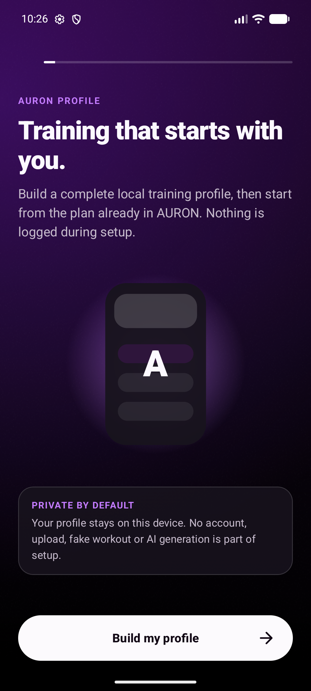

### Goal selection

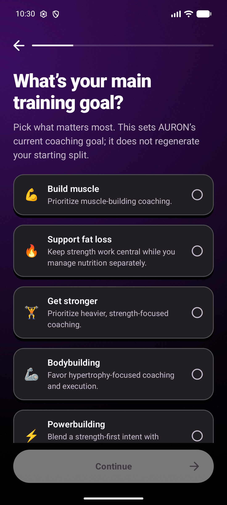

### Current schedule

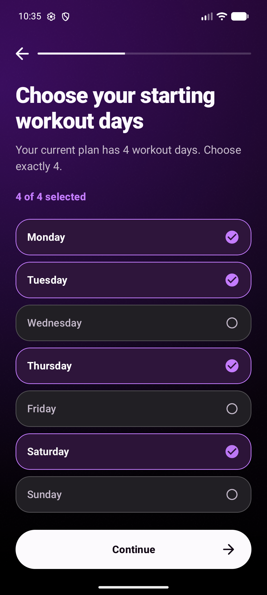

### Environment before equipment

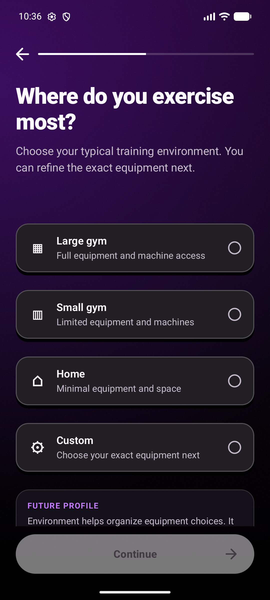

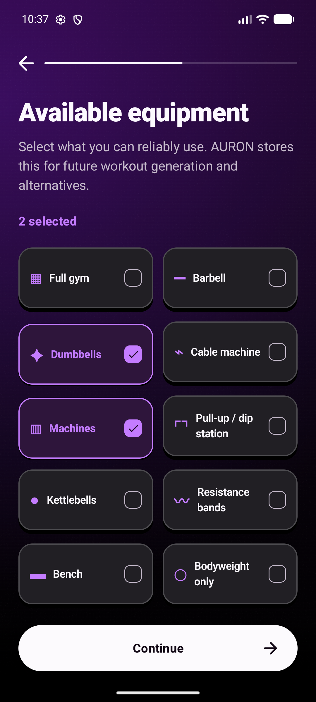

### Optional measurements and BMI boundary

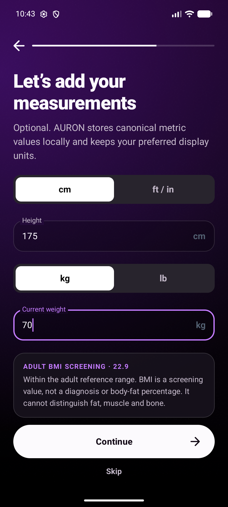

### Evidence and deterministic completeness

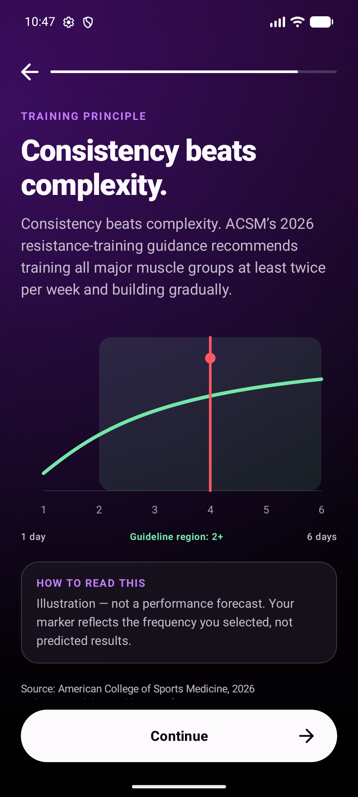

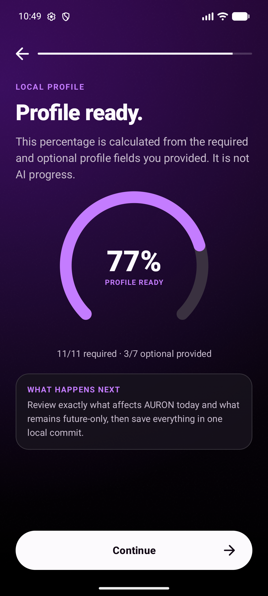

### Review and final receipt

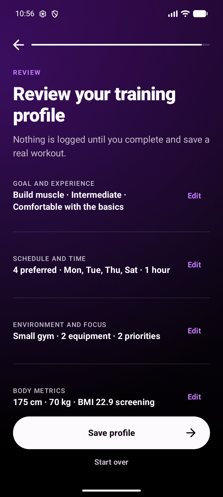

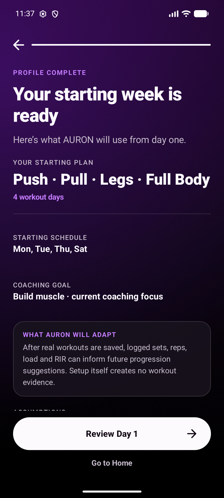

### No fake History

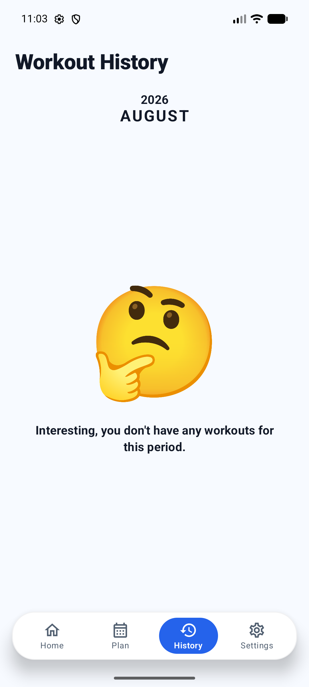

### 200% font and reduced motion

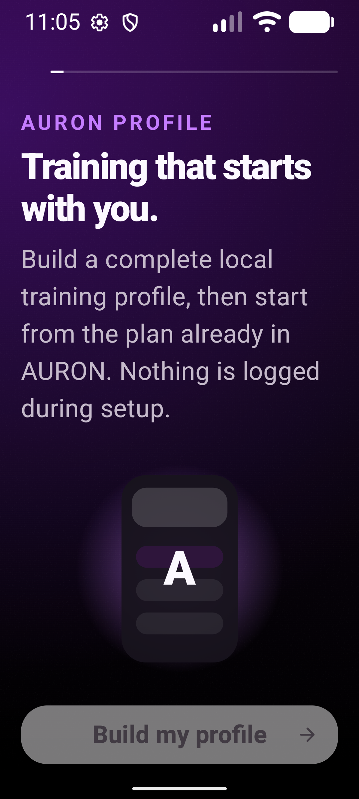

Intermediate screenshots documenting the system-bar fix, empty states, IME behavior, and the pre-copy-fix receipt remain in `docs/screenshots/onboarding_v3/` for auditability. The report uses the final versions as acceptance evidence.

## 14. Protected-surface verification

Every scope below was compared recursively or file-by-file against `_backup_onboardingv3_20260808_205149` using SHA-256:

| Protected surface | Files checked | Differences |
|---|---:|---:|
| `ProgressiveOverload.kt` | 1 | 0 |
| `ProgressiveOverloadEngineTest.kt` | 1 | 0 |
| Room schema exports | 8 | 0 |
| Catalog JSON | 1 | 0 |
| Catalog implementation | 12 | 0 |
| `AppDatabase.kt`, entities, DAO | 3 | 0 |
| `GymRepository.kt` | 1 | 0 |
| Workout draft/save owner | 1 | 0 |
| Seed/catalog version owner | 1 | 0 |
| Daily Boost domain and Home section | 2 | 0 |
| Muscle Recovery/Heat domain and Home section | 7 | 0 |
| History V2 | 3 | 0 |
| Session Review | 3 | 0 |
| Log Workout ViewModel/save path | 1 | 0 |
| Settings/import/export presentation | 3 | 0 |
| App Gradle and dependency catalog | 2 | 0 |

Current markers remain:

- Room database version **9**;
- catalog **577 exercises**;
- `CatalogSeed.CONTENT_VERSION = 16`;
- Progression Engine **V3.11B-MG / 152 engine tests**;
- Weekly Progress remains workout-only;
- Daily Boost remains excluded from Weekly Progress;
- floating bottom navigation implementation unchanged.

Selected unchanged SHA-256 evidence:

- Progressive Overload: `8D2355D55980B647CE327C7FF790718007FC97360A092886CE6EF5C88CBB957B`
- Progression tests: `FF4DDE81CE2A225EC09BEDA89C21CF8E9EFC0D633A36E79EBB233C7B9666B947`
- AppDatabase: `42EA850483CF84577F5438940518A9E1F5ABE5EA17B6680F5D9DE4A7A149760B`
- Room schema 9: `A228EE308E411CD7C0C7C952B9CAC5313B7BFF3A3502725E3D769E44E3209282`
- Catalog JSON: `C09E400ECC0289FC3AA408E306750209F06327796EF019A305B6F432F3BD4D69`
- GymRepository: `6F5EA12B1D1059F4C19B0F9177B2E1520439075AAAEF3312EED02F817A8FF952`

## 15. Graphify

The initial bare `graphify update .` command was unavailable on `PATH`. The project-owned interpreter recorded in `graphify-out/.graphify_python` was then used without installing or upgrading anything:

```powershell
& (Get-Content graphify-out\.graphify_python) -m graphify update .
```

Result:

- exit code 0;
- 932 code files re-extracted locally, no LLM/API extraction;
- 4,288 nodes;
- 8,122 edges;
- 307 communities;
- `graph.json`, `graph.html`, and `GRAPH_REPORT.md` updated.

Post-update `explain OnboardingTrainingProfile` found the new profile node and 27 extracted connections, including stable profile values, JSON codec, BMI types, equipment, goal, recovery, and constraint types. A path query also found the current `OnboardingViewModel → GymTrackerApp → UserPreferencesRepository` route relationship. The broad natural-language query remained noisy because the graph spans the full dirty project, so no unsupported semantic conclusion was taken from it.

Graphify warned that many non-code/sensitive/generated files produced zero nodes. This does not affect the successful Kotlin AST update and was not worked around by broadening sensitive-file access.

## 16. Known limitations

1. Figma Make source was not inspected because the supplied tab identity became stale; a new live mention is required for source-level parity review.
2. The V3 profile is intentionally not consumed by a plan generator. Future use requires a separate deterministic engine, ownership, tests, migration/rollback, safety, and claim contract.
3. Physical haptic quality is not measurable on the emulator.
4. TalkBack semantics are implemented and hierarchy-inspected, but complete human narration/order QA remains device-side.
5. Onboarding intentionally keeps its canonical dark AURON canvas when the global app theme is Light; Light-theme users retain readable system bars and all non-onboarding routes remain unchanged.
6. The existing AGP/compileSdk compatibility warning remains; dependencies were intentionally not upgraded.
7. The repository remains broadly dirty from pre-existing work. This task's ownership is defined by the timestamped backup comparison above.

## 17. Final acceptance

ONBOARDING-V3 is complete within the authorized scope:

- commercial-quality full profile flow implemented;
- real current consumers preserved;
- future-only inputs stored truthfully;
- no fake AI or fake workout evidence;
- versioned/resumable/atomic local persistence;
- legacy users safe;
- premium AURON visuals and reduced-motion path;
- JVM, connected, debug, profile, and release validation green;
- runtime screenshots captured;
- protected engine/schema/catalog/repository/history/save/draft/navigation surfaces verified unchanged;
- Graphify updated.

## 18. ONBOARDING-V3.1 correction — raised controls and ruler/schedule simplification (August 9, 2026)

V3.1 corrects the post-Figma presentation regression without replacing the V3 persistence architecture,
navigation owner or atomic completion path. The current V3 source was backed up before this correction at:

`D:\HOCTIN\GYM TRACKER\_backup_onboardingv31_20260809_134527`

The filesystem backup contains 1,307 files and 82,694,795 bytes. The user-provided source photographs in
`ảnh mẫu dùng cho onboarding` were retained unchanged; four optimized WebP copies were added as route-local hero
artwork.

### 18.1 Files changed by V3.1

Application source:

- `app/src/main/java/com/hoctin/gymtracker/ui/onboarding/OnboardingScreen.kt`
- `app/src/main/java/com/hoctin/gymtracker/ui/onboarding/OnboardingViewModel.kt`
- `app/src/main/java/com/hoctin/gymtracker/ui/onboarding/OnboardingComponents.kt`
- `app/src/main/java/com/hoctin/gymtracker/ui/onboarding/OnboardingModels.kt`
- `app/src/main/java/com/hoctin/gymtracker/ui/onboarding/OnboardingRulerMath.kt`
- `app/src/main/java/com/hoctin/gymtracker/ui/onboarding/OnboardingTrainingProfile.kt`
- `app/src/main/java/com/hoctin/gymtracker/ui/onboarding/OnboardingVisuals.kt`
- `app/src/main/res/drawable-nodpi/onboarding_hero_welcome.webp`
- `app/src/main/res/drawable-nodpi/onboarding_hero_goal.webp`
- `app/src/main/res/drawable-nodpi/onboarding_hero_experience.webp`
- `app/src/main/res/drawable-nodpi/onboarding_hero_environment.webp`

Focused JVM tests:

- `app/src/test/java/com/hoctin/gymtracker/ui/onboarding/OnboardingCopyContractTest.kt`
- `app/src/test/java/com/hoctin/gymtracker/ui/onboarding/OnboardingReducerTest.kt`
- `app/src/test/java/com/hoctin/gymtracker/ui/onboarding/OnboardingRulerMathTest.kt`
- `app/src/test/java/com/hoctin/gymtracker/ui/onboarding/OnboardingTrainingProfileTest.kt`

Documentation:

- `README.md`
- this existing report.

### 18.2 Removed and retained steps

The active flow is now:

`Welcome → Name → Gender → Age → Goal → Experience → Days per Week → Specific Days → Duration → Environment → Equipment → Priority Muscles → Physique → Measurements → Target Weight → Any Injuries? → Review → Receipt`

Removed from the active route:

- Compound-lift familiarity;
- the separate Recovery, Cardio and Pain questionnaires;
- Evidence and Profile Ready transition pages.

The persisted enum/storage values were not deleted. Resumed legacy steps normalize safely:

- Compound familiarity → Days per Week;
- Recovery → Any Injuries?;
- Evidence/Profile Ready → Review.

Gender storage remains backward compatible with all former values, while the active screen intentionally presents
only **Male** and **Female**. A small info action opens a concise local-storage/calculation-boundary dialog instead
of repeating support copy across four flat cards.

### 18.3 UI before and after

Before V3.1, the post-Figma screen used broad purple fills, flat Material-like rows, repeated explanatory text and
weak press depth. The current regression screenshot was treated as an anti-reference.

After V3.1:

- option, weekday, grid and CTA faces use translucent OLED black;
- a subtle light top/left hairline and deeper black lower/right layer create physical depth;
- option corners are 16–17dp instead of oversized soft cards;
- pressing scales the face to approximately 0.985 and moves it down 3.5–4dp while the depth collapses;
- release uses a restrained spring, and selection haptics occur only when the value actually changes;
- selected equipment remains depressed with a restrained purple border/check while unselected tiles keep depth;
- primary/secondary buttons use the same mechanical press language;
- page transitions are 340–360ms directional slide/fades, with short upward row staggering;
- disabled system animation removes translation, spring and stagger rather than hiding content.

Four local photos now support Welcome, Goal, Experience and Environment without turning every screen into an image
card. White/OLED black remain primary; purple is background identity and selected-state accent only.

### 18.4 Shared inertial ruler

`OnboardingRulerPicker` is the single active ruler composable and is reused for:

1. Days per Week, integer 1–7;
2. height, canonical centimeters;
3. current weight, canonical 0.1 kg;
4. target weight, canonical 0.1 kg.

The visual ruler is a centered `LazyRow` with Compose snap-fling behavior. Drag release therefore decelerates and
snaps to one evenly spaced tick. Canonical values are independent of labels, so metric/imperial toggles reformat
the same stored height/weight instead of converting an already rounded display value. The pure ruler math clamps,
maps and snaps indices without UI state. Tick haptics are throttled to at most one event per 48ms while the centered
item changes. TalkBack exposes progress plus increase/decrease actions. Reduced motion replaces inertial fling with
immediate snapping.

### 18.5 Schedule semantics

Schedule is now two committed steps:

- **Days per Week:** choose 1–7 on the horizontal ruler;
- **Specific Days:** choose exactly that number from seven raised Monday–Sunday rows.

The selected ISO weekdays continue to own the workout-only Weekly Progress target and planned/missed/rest calendar
meaning. Multiple workouts on one date still count once through the existing Consistency system. Daily Boost does
not increase Weekly Progress. V3.1 does not assign plan-day names to weekdays and does not generate or rewrite a
plan.

### 18.6 BMI formula and validation

Target screening uses:

`target BMI = target weight kilograms / (height meters × height meters)`

The raw, unrounded BMI controls validation; one-decimal rounding is display-only. This prevents a raw value such
as 18.475 from being rounded to 18.5 and incorrectly allowed. For adult-screened profiles, raw BMI below 18.5 shows
the red warning and disables Continue. BMI at or above 25 is not blocked. The warning calls BMI a screening value,
not a diagnosis, and no recommended-weight range is shown.

The existing age model groups ages 13–19 together. To honor the instruction not to apply adult thresholds to
minors, V3.1 conservatively skips the adult block for that entire bucket. This also means ages 18–19 in that bucket
do not receive the adult low-BMI block; splitting exact age from age range would require a separate persistence and
UX decision.

### 18.7 Persistence compatibility

- No onboarding preference key was deleted or renamed.
- Versioned draft resume and the existing atomic final commit remain owned by the current preference layer.
- `injuryNotes` is additive and nullable in JSON; a missing field restores to an empty value.
- Former compound/recovery/cardio/pain fields remain nullable and decodable, so old V3 drafts do not crash.
- Inactive stored steps normalize to the nearest active continuation rather than restarting the flow.
- Goal and weekday production values still use their existing owners.
- `tracking_start_epoch_day` is unchanged and is not moved by reconfiguration.
- Completion still creates no workout, session, workout draft or History row.

### 18.8 Tests and APK builds actually run

Commands run:

```powershell
.\gradlew.bat :app:testDebugUnitTest --console=plain
.\gradlew.bat :app:assembleDebug --console=plain
.\gradlew.bat :app:assembleRelease --console=plain
```

Results:

- `testDebugUnitTest`: **396 tests, 0 failures, 0 errors, 0 skipped**;
- `assembleDebug`: success;
- `assembleRelease`: success;
- debug APK: `app/build/outputs/apk/debug/app-debug.apk`, 99,294,726 bytes,
  SHA-256 `A2DC3485960838B6A8DAEEE924BCC0A4AFA86A30BBB6D58A845A281B6F8BE039`;
- release APK: `app/build/outputs/apk/release/app-release.apk`, 92,160,610 bytes,
  SHA-256 `BA3C878826322E0FB4CF8CF20D339E5223252C5F63ADAFEC579F3DA5DC07CEA4`.

The first full JVM pass exposed a raw-versus-rounded BMI edge at 18.475; the validator was corrected to use raw
BMI and the complete suite then passed. New focused evidence covers ruler snapping/conversion, 0.1 kg
resolution, active-step traversal, inactive-step resume normalization, exactly-N weekdays, two active gender
choices, optional injury notes, legacy JSON without `injuryNotes`, low/high BMI boundaries and the teen no-block
path.

The existing Android Gradle Plugin/compileSdk compatibility warning remains. Dependencies were intentionally not
upgraded.

### 18.9 Runtime QA and screenshots

**V3.1 runtime QA was not performed.** No disposable or otherwise verified-safe device state was available. In
accordance with the task's data-safety boundary:

- no connected test was run;
- no APK was installed;
- no package data was cleared;
- no app was uninstalled;
- no emulator was wiped or mutated;
- no signature mismatch occurred because installation was not attempted.

Consequently, this section intentionally provides no V3.1 runtime screenshots. Screenshots earlier in this report
are historical V3 evidence and must not be interpreted as visual acceptance of the V3.1 correction. Remaining
manual checks are: drag/fling feel, press-depth timing, physical haptic cadence, modal/IME behavior, font scaling,
TalkBack order, reduced motion and final full-flow screenshots on a disposable device.

### 18.10 Protected-surface verification

A recursive SHA-256 comparison of current `app/src` against the V3.1 backup found exactly 15 changed files: the
seven onboarding Kotlin files, four focused onboarding JVM test files and four onboarding WebP assets listed
above. **Unexpected non-onboarding changes: 0.**

Additional unchanged checks:

- `ProgressiveOverload.kt` and `ProgressiveOverloadEngineTest.kt`;
- all 1,156 files under `app/src/main/assets`, including catalog data;
- `GymRepository.kt`;
- `GymTrackerApp.kt`;
- `UserPreferencesRepository.kt`;
- `app/build.gradle.kts`, `gradle/libs.versions.toml` and `gradle.properties`.

This correction therefore does not change Room/schema, Progressive Overload, catalog, repository behavior,
History grouping, import/export, save/draft, Daily Boost, floating-navigation ownership, signing or dependency
versions.

### 18.11 Known limitations

1. Visual/runtime acceptance remains pending on a disposable device; build success is not a substitute for it.
2. Physical haptic quality cannot be inferred from JVM tests.
3. The 13–19 age bucket forces a conservative teen policy for ages 18–19 as documented above.
4. Profile fields beyond current goal/weekdays remain future context; V3.1 does not add a plan generator.
5. The repository was already broadly dirty. Task ownership is bounded by the timestamped backup and the exact
   15-file `app/src` comparison.

### 18.12 V3.1 acceptance status

Source-level correction, JVM validation and debug/release assembly are complete. Runtime visual, gesture,
accessibility and physical-haptic acceptance remain honestly pending until a disposable device is available.

### 18.13 Follow-up — blank Gender choice regression

The first device screenshot after V3.1 showed the Gender heading, info action and disabled Continue button, but no
Male/Female cards. This was a layout-measurement regression, not missing profile state, failed JSON restoration or
an image-loading problem.

Root cause:

1. `OnboardingStepBody` applies 24dp horizontal page padding.
2. On a common approximately 360dp logical-width phone, `OnboardingBinaryChoiceGrid` therefore receives roughly
   312dp of content width.
3. The grid used `maxWidth < 350.dp` as its stacked-layout threshold, so normal phones incorrectly entered the
   one-column fallback.
4. In that fallback, `BinaryChoiceCard` had no `fillMaxWidth`; its visible children used `matchParentSize()`, which
   does not contribute to the parent's measured width.
5. The card consequently measured to zero width. Stagger animation still completed, but there was no horizontal
   surface or text to draw.

Correction:

- common content widths such as 300–312dp now retain the intended two-card horizontal composition;
- the one-column fallback is reserved for content below 270dp or font scale at/above 1.6×;
- both the one-column container and every fallback card explicitly use `fillMaxWidth()`;
- the horizontal `Row` also explicitly fills the available width;
- no state, enum, JSON, ViewModel, repository or persistence behavior changed.

A pure regression test locks the responsive decision:

- 312dp at 1.0× font → two columns;
- 300dp at 1.3× font → two columns;
- 260dp → one full-width column;
- 312dp at 1.6× font → one full-width accessibility column.

Follow-up validation actually run:

- focused `OnboardingReducerTest`: pass;
- full `testDebugUnitTest`: 396 tests, 0 failures/errors/skips;
- `assembleDebug`: success;
- `assembleRelease`: success;
- no connected test was run.

Read-only device discovery was attempted after the builds. ADB reported no connected device, and the Android
emulator tool listed no available AVD. Therefore no APK was installed and no V3.1 follow-up screenshot could be
captured safely. The source-level cause and measurement contract are fixed and tested, but final visual acceptance
on a disposable device remains pending.

### 18.14 Follow-up — compact-device equipment, target guidance and staged receipt (August 10, 2026)

This follow-up remains part of ONBOARDING-V3.1. It corrects the reported Samsung compact-device regression and
does not introduce a second onboarding design, state owner or report.

#### Backup and files changed

Pre-edit backup:

`D:\HOCTIN\GYM TRACKER\_backup_onboardingv31_compat_20260810_115152`

Source and focused tests changed relative to that backup:

- `app/src/main/java/com/hoctin/gymtracker/ui/onboarding/OnboardingComponents.kt`;
- `app/src/main/java/com/hoctin/gymtracker/ui/onboarding/OnboardingModels.kt`;
- `app/src/main/java/com/hoctin/gymtracker/ui/onboarding/OnboardingScreen.kt`;
- `app/src/main/java/com/hoctin/gymtracker/ui/onboarding/OnboardingTrainingProfile.kt`;
- `app/src/test/java/com/hoctin/gymtracker/ui/onboarding/OnboardingReducerTest.kt`;
- `app/src/test/java/com/hoctin/gymtracker/ui/onboarding/OnboardingTrainingProfileTest.kt`.

Documentation updated in place:

- `README.md`;
- this report.

No other file in the follow-up backup changed.

#### Confirmed compact-device root cause and correction

The Equipment screen did not fail because equipment data was missing. Its responsive grid entered the one-column
branch on compact/high-font-scale devices. In that branch the stagger wrapper and tile had no explicit width, while
the visible raised face and depth layer used `matchParentSize()`. `matchParentSize()` cannot establish its parent's
size, so a tile could measure to zero width. The old `AnimatedVisibility` stagger also removed each item from layout
measurement during its initial delay. Equipment remained required, so the invisible page also disabled Continue
and made every later screen unreachable. Pixel 8 stayed on the two-column path and therefore hid the bug.

The correction:

- gives the grid, every row, every stagger wrapper and every tile an explicit width contract;
- keeps the intended two-column layout at ordinary phone widths;
- uses a full-width single column only below 285dp content width or at 1.5× font scale and above;
- replaces measurement-removing `AnimatedVisibility` with an always-measured alpha plus 10dp upward entrance;
- adds pure regression tests for common, compact and large-text thresholds.

This is the same Compose measurement family as the earlier blank Male/Female regression, but in the reusable
multi-choice grid used by Equipment, Priority Muscles and Physique.

#### Motion, press and responsive type

The root page transition is now fade-only: 430ms enter and 310ms exit. This removes the diagonal visual caused by
combining a horizontal page transition with the upward option-row stagger. Reduced motion uses a short 90ms
dissolve and no stagger translation.

Question typography is selected from post-padding content width instead of one fixed size: compact widths use
27–30sp titles and normal widths use 34sp, with corresponding line heights. Page horizontal padding also contracts
from 24dp to 20dp or 16dp on smaller windows. This keeps headings such as `What weight feels right for you?` in a
controlled two-line composition rather than creating arbitrary three-line wraps.

Raised primary/secondary buttons, binary cards, option rows and multi-choice tiles now add a restrained black press
overlay while the face shifts down and the depth collapses. The ruler viewport also darkens while actively dragged.
Selection and ruler haptic ownership is unchanged.

#### Target-weight range and screening behavior

For adult-screened profiles, the reference range is calculated from the current height using:

`weight = BMI × height metres²`

The lower bound uses BMI 18.5 and rounds upward; the upper bound uses BMI 24.9 and rounds downward. This keeps the
displayed integer range inside the reference interval. At 166cm the result is **51–68kg**. The same canonical values
are converted only for imperial display.

Raw, unrounded target BMI still owns validation:

- below 18.5: translucent red enclosure, red hairline, bold height/BMI/18.5 evidence, the red instruction
  `Please select a higher goal weight to continue.`, and Continue disabled;
- 18.5–24.9: non-diagnostic within-reference copy;
- 25 or above: amber non-blocking advisory; high BMI is not hard-blocked;
- age group 13–19: no adult threshold, range or block is applied.

BMI remains a screening value, not a diagnosis. The implementation follows the adult formula and thresholds in
WHO guidance; it does not create a nutrition, medical or rate-of-change recommendation.

Measurements and Target Weight no longer show an active Skip button. Name, Priority Muscles, Physique and the
multiline injury note remain optional. Legacy nullable/skipped values stay decodable and the versioned resume and
atomic final commit are unchanged.

#### Ten-second receipt presentation

Receipt now has a deterministic presentation timeline tied only to elapsed time:

1. 0–5 seconds: 1–45%, `Calculating…`, `Parsing your goals and equipment…`;
2. 5–6 seconds: 45–60%, `Building your setup…`, `Crafting a foundation around your schedule and level…`;
3. 6–10 seconds: 60–100%, `Personalizing…`, `Optimizing your profile structure for streamlined progress…`.

The final phase rotates six unequal time/progress segments from a per-entry seed, producing irregular visible
cadence while remaining monotonic and exactly ten seconds. At 100%, a 520ms crossfade reveals `Your training
profile is ready`. With system animation disabled, the presentation resolves immediately. The timeline is
presentation-only: it does not claim AI execution, generate/replace a plan or create workout/session/history data.

#### Validation actually completed

Commands:

```powershell
.\gradlew.bat :app:testDebugUnitTest --console=plain
.\gradlew.bat :app:assembleDebug --console=plain
.\gradlew.bat :app:assembleRelease --console=plain
```

Results:

- full JVM suite: **400 tests, 0 failures, 0 errors, 0 skipped**;
- debug APK: success, 99,642,010 bytes, SHA-256
  `68DE9B6C93BD2F8A9B4AFFB1722B1230213DF2EBC751421620668F0FEEA106A9`;
- release APK: success, 92,167,074 bytes, SHA-256
  `B6A3BB4A98662F2662A840642107CF9F786B51EBF3BB8ACBE9573A7765E57443`.

The first release attempt exposed stale Kotlin incremental output: onboarding could not resolve three existing
main-source helpers. A full `compileReleaseKotlin --rerun-tasks --no-build-cache` succeeded without any helper or
owner duplication; the subsequent release assembly passed. This was build-cache state, not a release-only source
change.

Read-only device discovery returned no connected ADB device. Therefore:

- no APK was installed;
- no connected/instrumented test was run;
- no app data was cleared;
- no uninstall, emulator wipe or signature-risking operation occurred;
- no new runtime screenshot was captured.

`graphify update .` completed and rebuilt the local code graph to 4,394 nodes / 8,293 edges / 318 communities.
A focused query resolves the updated `OnboardingMultiChoiceGrid`, `OnboardingStepBody`, `OnboardingUiState` and
training-profile sources. Graphify continues to report its known extractor warning for 889 files that produce zero
AST nodes. One permitted retry found no topology change and repeated the same warning, so no force update or retry
loop was used.

The compact-device cause is source-confirmed and covered by pure measurement tests, but final visual acceptance on
the reported Samsung class of device remains pending until a disposable/safe device is available.

#### Protected-surface verification and limitations

The current protected engine, engine test, `GymRepository`, `UserPreferencesRepository`, `GymTrackerApp`, Gradle
configuration and 1,156 catalog/asset files remain byte-identical to the August 9 V3.1 baseline backup. Room schema
files retain their pre-task timestamps; the newest remains July 14, 2026. This follow-up did not modify Room,
Progressive Overload, catalog, repositories, History grouping, import/export, save/draft, Daily Boost, floating
navigation, signing or dependency versions.

Remaining runtime checks are compact Samsung rendering, 200% font scaling, reduced motion, TalkBack order, physical
haptic cadence, ruler fling feel and the complete ten-second receipt timing on a safe device. Build and JVM success
must not be interpreted as that pending visual/runtime acceptance.
