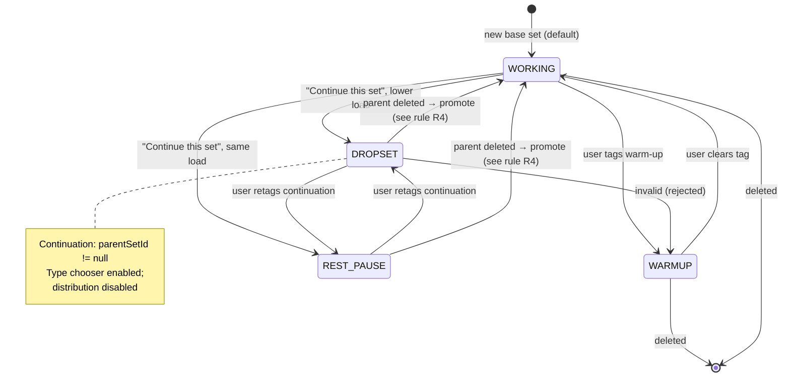

# AURON Set Type Architecture and Evidence Plan

Status: research + design only. No production Kotlin, test, schema, migration, import/export, or Gradle
change was made while producing this document.

Repository root confirmed: `D:\HOCTIN\GYM TRACKER` (`git rev-parse --show-toplevel`).
Branch `master`, working tree already dirty before and after this task — preserved untouched.
Source of truth for constraints: `README.md` (critical safety rules), `AGENTS.md`, and
`docs/advset_accuracy_context_audit.md` (the companion current-state audit produced earlier).

---

## 1. Executive Decision

- **Recommendation: IMPLEMENT** — staged, and gated on two sub-decisions that are **DESIGN_ONLY /
  BLOCKED** until evidence or a product decision exists (see the gating list below).

**Conclusion.** AURON can and should persist set type on the single canonical `logged_sets` ledger.
The current app already lets a user tag a set Warm-up or Dropset and already lets them create one
continuation child through "Continue this set", but **none of that survives the save**
(`LoggedSetEntity` and `SetInput` have no such field; see §2). That is the honest place to start: make
the user's stated intent durable, in the smallest additive way, and keep every existing engine
behavior byte-for-byte identical for rows that are ordinary working sets. The critical architectural
safety property is that **filtering happens before the frozen Progression Engine, not inside it** —
so the engine file stays untouched while progression finally reads the right sets. For Muscle Heat and
Muscle Recovery the honest answer is narrower: AURON can persist and count *what was performed*, but
it has **no evidence base** to convert a drop set or rest-pause cluster into a distinct physiological
recovery cost. Therefore V1 must declare its coefficients as product constants explicitly labelled
`MODEL_LIMITATION`, not as biology.

**Safe to implement now (Milestones 1–3):**

1. Additive nullable columns on `logged_sets` (`setType`, `parentSetId`) + Room v11 → v12 additive
   migration. Legacy rows decode as `WORKING` with `parentSetId = NULL`, so existing history is
   re-read exactly as today.
2. Persist the intent end-to-end: `SetDraft` → `SetInput` → `LoggedSetEntity` → export/import JSON
   (optional key, tolerant import) → draft SharedPreferences (optional key, tolerant restore).
3. Progression filtering **at the data-supply boundary** (the ViewModels that already pass history to
   `ProgressiveOverloadEngine`), so `domain/ProgressiveOverload.kt` is not modified at all.
4. UI: keep the existing "⋮" overflow sheet as the single entry point; add `Working set` and
   `Rest-pause` to the existing type chooser; rest-pause and drop sets are created as continuations
   with a real `parentSetId`.

**Must wait for evidence or a separate product decision (gated):**

| Gate | Decision needed | Why it is blocked |
|---|---|---|
| G1 — separate Heat/Recovery coefficients for DROPSET and REST_PAUSE | Product + evidence | No retrieved source quantifies *local recovery cost per set type*. Available meta-analyses measure hypertrophy/strength outcomes, not recovery cost. See §3. |
| G2 — automatic warm-up detection | Product | AURON stores no 1RM, no %1RM anchor, and no per-exercise working-weight history at save time that could define "light". Auto-classification would be invention. See §7. |
| G3 — `restBeforeSeconds` as a first-class field | Product | It is an app-observed timing signal, not proof of physical rest. Late entry, backgrounding, and multi-tasking make it temporally uncertain. See §3.4. |
| G4 — program-level / coach-preset progression eligibility | Product | Requires a program configuration concept that does not exist in the schema today. |

---

## 2. Current-State Architecture

### 2.1 Current logged-set lifecycle

1. **Draft entry.** `LogWorkoutViewModel` holds `draftsByExercise: MutableMap<Long, MutableList<SetDraft>>`
   (`ui/log/LogWorkoutViewModel.kt:63-66`). `SetDraft` carries the measurements **plus** transient
   `setType`, `weightDistribution`, `continuationOfKey`, and `researchRowKey`.
2. **Draft persistence.** `draftEntriesSnapshot()` (`:869-887`) serializes to
   `WorkoutDraftRepository.DraftSet` (`data/WorkoutDraftRepository.kt:9-20`) in SharedPreferences
   (`gym_tracker_workout_drafts`, key `draft_<dayId>`, `WORKOUT_DRAFT_SCHEMA_VERSION = 3`).
   **Continuation rows and advanced metadata are deliberately filtered out** (`:871-885`), so a
   process restore cannot misrepresent a continuation as a base set.
3. **Save.** `buildInputs()` (`:1027-1046`) → `List<ExerciseLogInput>` whose `SetInput`
   (`data/GymRepository.kt:13-25`) carries only weight/reps/rir/notes/duration/distance plus
   `sourceDraftOrdinal` and `sourceDraftKey`. **`setType` and `continuationOfKey` are dropped here.**
4. **Persist.** `GymRepository.persistWorkoutSession()` (`:442-528`) writes `WorkoutSessionEntity`,
   then one `LoggedSetEntity` per parsed row with `setNumber = index + 1` (`:497`), computes PR flags
   sequentially (`:486-492`), and returns `sourceDraftKeyBySetId` for research linkage (`:518-527`).
5. **Read-back.** `GymDao.getRecentSetsForExercise` (`:231`) orders
   `workout_sessions.startedAtMillis DESC, logged_sets.setNumber ASC`;
   `getRecentSetsForCanonicalKey` (`:265`) is the cross-day path.
6. **Consumption.** Progression (`LogWorkoutViewModel`, `ExerciseDetailViewModel`), Muscle Heat
   (`SessionMuscleHeatUseCase.forSession`), Muscle Recovery (`HomeViewModel`), History/Session Review,
   and the research/wearable shadow pipelines.

### 2.2 File-level map

| File | Role today | Junction risk for set types |
|---|---|---|
| `data/Entities.kt:129-165` | `LoggedSetEntity` (13 columns, v6+ nullable `canonicalExerciseKey`) | New columns land here; FK to `workout_sessions` with `onDelete = CASCADE` |
| `data/AppDatabase.kt:60`, `:309-361` | `version = 11`, `MIGRATION_10_11` | New `MIGRATION_11_12` must be additive only |
| `data/GymRepository.kt:13-25` | `SetInput` (save contract) | Must carry type + parent key |
| `data/GymRepository.kt:56-91` | `loggedSetToExportJson` / `loggedSetFromImportJson` | Optional keys; old files must still import |
| `data/GymRepository.kt:545-616`, `:618-682` | `exportJson` (`schemaVersion = 6`) / `importJson` | Tolerant importer; replace-all semantics |
| `data/WorkoutDraftRepository.kt:9-20`, `:29-78` | `DraftSet` + serialize/parse (v3) | Optional keys for type/parent |
| `ui/log/LogWorkoutViewModel.kt:63-66`, `:394`, `:444-459`, `:488-529`, `:869-887`, `:1023-1065` | Draft model, add/remove/update set, set type, continuation, draft snapshot, save inputs | Largest change surface |
| `ui/log/LogWorkoutScreen.kt:1346-1393`, `:1417-1475`, `:1780-1849` | Badges, set row, `AdvancedSetSheet` | UI entry point |
| `ui/log/LogWorkoutInteractionModels.kt:7-12` | `LogSetType { STRAIGHT, WARMUP, DROP }`, `LogWeightDistribution`, `RestTimerUnit` | Enum must become the persisted enum |
| `domain/ProgressiveOverload.kt:2178-2290` | `evalSession`, `metrics`, `modeWeight` | **Frozen** — must not be edited |
| `domain/muscleheat/MuscleExposure.kt:103-171` | Layer A counting (`isValidSet`, 1.0 set-equivalent per set) | Type-aware counting |
| `domain/muscleheat/MuscleHeatEngine.kt:70-172` | Layer B quality/status | Type-aware quality (gated G1) |
| `domain/muscleheat/MuscleRecovery.kt:281+` | Bi-exponential decay over the same seed | Inherits every Heat error |
| `domain/muscleheat/SessionMuscleHeatUseCase.kt:32-71` | Joins sets → canonical key → catalog muscles | Must pass type through |
| `ui/history/HistoryScreen.kt:430-467`, `HistorySessionMapper.kt:18-31` | Renders `Set N` from `setNumber` | Continuation grouping must not corrupt numbering |
| `ui/review/SessionReviewViewModel.kt` | Post-save heat review | Same session pipeline |

### 2.3 Current data flow

```mermaid
flowchart TD
    A["SetDraft (transient)<br/>setType, continuationOfKey"] -->|"draftEntriesSnapshot()<br/>continuations FILTERED OUT"| B["WorkoutDraftRepository<br/>SharedPreferences v3"]
    B -->|parse| A
    A -->|"buildInputs()"| C["SetInput<br/>weight/reps/rir/notes/dur/dist<br/>+ sourceDraftKey<br/>setType DROPPED"]
    C --> D["GymRepository.persistWorkoutSession()<br/>setNumber = index + 1"]
    D --> E["LoggedSetEntity (Room v11)<br/>NO set type, NO parent key"]
    E --> F["GymDao.getRecentSetsForExercise /<br/>getRecentSetsForCanonicalKey"]
    F --> G["ProgressiveOverloadEngine<br/>FROZEN: evalSession / modeWeight"]
    E --> H["SessionMuscleHeatUseCase"]
    H --> I["MuscleExposureCalculator<br/>every reps>0 set = 1.0"]
    I --> J["MuscleHeatEngine (quality x raw)"]
    J --> K["MuscleRecoveryEngine<br/>bi-exponential, seed = stimulus"]
    E --> L["History / Session Review<br/>"Set N" = setNumber"]
    E --> M["exportJson schemaVersion 6<br/>/ importJson tolerant"]
```

### 2.4 Current assumptions at risk

| # | Assumption baked into current code | Why set types break it |
|---|---|---|
| A1 | Every row in `logged_sets` is an independent working set | Warm-ups and continuations are persisted as peers (`GymRepository.kt:493-507`) |
| A2 | `setNumber` is both display order and set identity | Continuations renumber into the sequence, so "Set 4" may be a drop child of Set 3 |
| A3 | Main working weight = most frequent load (`modeWeight`, `ProgressiveOverload.kt:2285`) | Warm-up or drop rows can outnumber working rows and become the mode |
| A4 | Rep count per row is a full working-set rep count | A rest-pause cluster legitimately yields 8 / 4 / 3 reps; `tooHeavy = avgReps < minRep × 0.70` then fires (`ProgressiveOverload.kt:2249`) |
| A5 | One row = one unit of training exposure (`MuscleExposure.kt:108`, `1.0` set-equivalent) | 3 warm-ups + 3 working + 2 drops currently score 8 |
| A6 | `avgRir` over all rows describes session quality | Warm-ups at RIR 4–5 dilute the quality modifier (`MuscleHeatEngine.kt:128`) |
| A7 | Sets heavier than the mode are irrelevant to classification | `evalSession` only classifies lighter rows as ramp/back-off (`ProgressiveOverload.kt:2206-2211`), so heavier rows vanish silently |
| A8 | Draft restore preserves everything the user typed | Continuation rows are intentionally dropped (`LogWorkoutViewModel.kt:871-885`) |

### 2.5 Existing "⋮" menu behavior

`SetRowMenu` (`ui/log/LogWorkoutScreen.kt:1380-1393`) is a 40 dp tap target that opens
`AdvancedSetSheet` (`:1780-1843`), a bottom-anchored `AuronCompactModalSheet`, **not** a dropdown.
Contents today:

- Title `Set #N` or `Continuation of Set #N`.
- **Set Type** segmented control: `Straight Set` / `Warmup Set` / `Dropset`
  (`LogSetType.STRAIGHT / WARMUP / DROP`), disabled on continuation rows (`:1830`).
- **Weight Distribution**: `Total` / `Each Side` / `Left Side` / `Right Side`, disabled on continuation
  rows (`:1838`).
- Footer: white `Continue this set` (hidden for continuations) + red outlined `Delete Set`.

`continueSet()` (`LogWorkoutViewModel.kt:504-519`) inserts a child draft immediately after the parent
with `weight` and `rir` copied and `reps` blank; **one child maximum per parent** (`:507`). Same weight
+ fewer reps = rest-pause in practice; lower weight = drop set. `removeSet()` (`:454-459`) removes the
target and, when deleting a parent, also removes its children; it refuses to remove the last base set.
Row presentation: `SetTypeBadge` draws `W` / `D` (`:1396-1411`); `SetIndexBadge` draws the number, or a
branch arrow for continuations (`:1346-1374`).

---

## 3. Evidence and Epistemic Boundaries

### 3.1 Directly observed current-source facts

Retrieved by reading the repository on 2026-09-08/09.

1. `LoggedSetEntity` has no set-type or parent-key column (`data/Entities.kt:141-165`).
2. `SetInput` has no set type (`data/GymRepository.kt:13-25`).
3. `buildInputs()` drops `setType` and `continuationOfKey` (`ui/log/LogWorkoutViewModel.kt:1027-1046`).
4. Saved rows are renumbered `setNumber = index + 1` (`data/GymRepository.kt:497`).
5. `README.md:205-209` states the advanced labels are *"intentionally transient: they do not yet
   change progression, volume, History, recovery or saved set semantics."*
6. `setType` today influences exactly one thing: the transient `repeatedDropSetCaution` flag
   (`ui/log/LogWorkoutViewModel.kt:986-988`).
7. Room is v11; every prior migration touching a user table is a single nullable
   `ALTER TABLE ... ADD COLUMN` (`data/AppDatabase.kt:170-174`, `:189-192`, `:237-244`, `:256-259`,
   `:269-272`), and there is **no `fallbackToDestructiveMigration`** anywhere (`:364-383`).
8. Export is `schemaVersion = 6`, key-based, tolerant of missing keys; import rewrites everything via
   `dao.replaceAllData` (`data/GymRepository.kt:545-682`).
9. Draft persistence is SharedPreferences JSON at schema v3, tolerant of missing keys
   (`data/WorkoutDraftRepository.kt:29-78`).
10. Muscle Heat Layer A counts any set with `reps > 0` as 1.0 set-equivalent
    (`domain/muscleheat/MuscleExposure.kt:108`, `:167-171`).
11. Muscle Recovery seeds off that same stimulus and decays bi-exponentially
    (`domain/muscleheat/MuscleRecovery.kt:281-320`), with a 1.3× structural half-life stretch when
    `recoveryRisk` (`:212`).
12. `domain/ProgressiveOverload.kt` is frozen by README policy (`:33-35`); 152 engine unit tests exist
    (`README.md:61-62`).
13. History renders `Set N` directly from `setNumber` (`ui/history/HistoryScreen.kt:467`,
    `HistorySessionMapper.kt:18-31`).

### 3.2 External evidence-backed conclusions (sources actually retrieved)

**E1 — Drop sets vs traditional sets for hypertrophy.**
Sødal LK, Kristiansen E, Larsen S, van den Tillaar R. *Effects of Drop Sets on Skeletal Muscle
Hypertrophy: A Systematic Review and Meta-analysis.* **Sports Med Open. 2023;9:66.**
DOI `10.1186/s40798-023-00620-5`; PMID 37523092; PMCID PMC10390395. Retrieved from
<https://pmc.ncbi.nlm.nih.gov/articles/PMC10390395/>.
Key retrieved statements: 6 studies / 142 participants (5 studies / 101 in the quantitative synthesis);
between-group hypertrophy difference **not significant** (SMD 0.155, p = 0.392); both groups improved
significantly pre→post (drop set 0.555; traditional 0.437); drop-set modalities took "half to one-third
of the time"; authors call the results **preliminary** with low statistical power.

**E2 — Advanced systems (incl. rest-pause and drop sets) vs traditional multiple sets.**
Tsartsapakis I, Zafeiroudi A, Kouthouris C. *Effects of Advanced Resistance Training Systems on Muscle
Hypertrophy and Strength in Recreationally Trained Adults: A Systematic Review and Meta-Analysis.*
**J Funct Morphol Kinesiol. 2026.** DOI `10.3390/jfmk11010080`; PMID 41718208; PMCID PMC12922048.
Retrieved from <https://pubmed.ncbi.nlm.nih.gov/41718208/>.
Key retrieved statements from the abstract: 23 studies; pooled advantage for advanced systems small but
significant (g = 0.159); **strength** moderate and significant (g = 0.351); **hypertrophy** small and
**non-significant** (g = 0.046); "Rest-pause training demonstrated a modest hypertrophic advantage";
"Drop sets, tempo-controlled training and cluster-type protocols produced adaptations comparable to
traditional sets when volume and effort were matched"; "Their hypertrophic superiority is not supported
at the aggregate level".

**E3 — Proximity-to-failure / RIR estimation.**
*Influence of Varying Proximity-to-Failure on Muscular Adaptations and Repetitions-in-Reserve
Estimation Accuracy in Resistance-Trained Individuals.* J Sports Sci (JOSISAE), 2025,
DOI `10.1007/s42978-025-00338-8`. Retrieved via
<https://link.springer.com/article/10.1007/s42978-025-00338-8>.
Key retrieved statement: "RIR accuracy is already acceptable at baseline in resistance-trained
individuals" and improved across RIR 1–4 conditions.

**What E1–E3 support.** Drop sets and rest-pause are *legitimate training methods producing broadly
comparable hypertrophy and, in the aggregate, at least comparable (sometimes favourable) strength
outcomes*; RIR self-report is usable but imperfect and improves with practice. Therefore:
tagging these sets must **not** be treated as a fraud signal, and excluding them from *straight-set
progression* is a **measurement-protection** decision (protect the "clean performance at this load"
question), **not** a claim that the work did not count.

### 3.3 Inferences

- I1. Layer A's flat 1.0 set-equivalent is defensible only if the input set is a *performed working
  set*. Once warm-ups and clusters are tagged, a flat count over-counts real stimulus. *(Inference from
  §3.1 items 10–11 plus the product question "what real local stress did this muscle receive".)*
- I2. `modeWeight` is a proxy for "the load you intended to work at". A persisted `setType` lets AURON
  replace the positional ramp/back-off heuristic with the user's stated intent for **new** rows, while
  legacy rows keep the heuristic. *(Inference from `ProgressiveOverload.kt:2196-2217`.)*
- I3. Rest-pause at the *parent's* weight is the single highest-risk pattern, because it joins
  `workingSets` and drags `avgReps` below the 70% guard. *(Inference from
  `ProgressiveOverload.kt:2240-2261` and `LogWorkoutViewModel.kt:504-519`.)*

### 3.4 MODEL_LIMITATION items

- **M1 (no physiological coefficients).** No retrieved source quantifies *local recovery cost* or
  *muscle-damage cost* per set type. Any DROPSET/REST_PAUSE multiplier in Muscle Heat or Muscle
  Recovery is a **product constant**, and must be shipped labelled `MODEL_LIMITATION`.
- **M2 (warm-up has no universal definition in AURON's data).** AURON stores no 1RM, no %1RM estimate,
  and no per-exercise working-weight anchor, so "a warm-up is 50–60 % of working load" is not
  computable from current data. Warm-up must be **user-declared**, and auto-suggestion must abstain.
- **M3 (timing is not physics).** `restBeforeSeconds` would be derived from app-observed events. Late
  entry, app backgrounding, and phone locking break its temporal validity. It may inform a *suggestion*,
  never a claim about physical rest, and never a progression decision on its own.
- **M4 (volume load is not muscle damage).** `weight × reps` is a mechanical-work proxy. It must never
  be presented as, or internally equated with, local tissue damage or recovery debt.
- **M5 (self-reported RIR).** Heat quality, PO gates, and the grind/recovery-risk flag all key off
  user-estimated RIR; E3 says it is acceptable, not exact.
- **M6 (single-subject, local-first).** AURON has no population baseline. Longitudinal recovery
  scenarios can only be validated as *self-consistency*, not as accuracy against ground truth.

### 3.5 What AURON cannot infer from logs (explicit)

1. Whether a set was physiologically a warm-up for *this* user on *this* day.
2. Whether a short observed gap was a deliberate 20-second rest-pause or the user answering a message.
3. The actual time under tension, tempo, or range of motion of any set.
4. Local muscle damage, inflammation, or readiness — only a modelled proxy from performed work.
5. Whether a user's set-type tag is truthful — only internal consistency can be checked.
6. Whether a strength drop is caused by fatigue, technique, equipment, or a logging mistake.

---

## 4. Proposed Domain Model

### 4.1 Recommended fields

Added to `logged_sets` as **nullable, additive** columns. Stored enum by name (matches the
`sourceType` / `readiness` precedent), never an ordinal.

| Column | Type | Default (new rows) | Semantics |
|---|---|---|---|
| `setType` | TEXT NULL | `'WORKING'` | `WARMUP`, `WORKING`, `DROPSET`, `REST_PAUSE`. NULL = legacy row, interpreted as `WORKING`. |
| `parentSetId` | INTEGER NULL | NULL | Set id of the initiating set when this row is a continuation; NULL for independent sets. |
| `groupOrdinal` | INTEGER NULL | NULL | 1-based continuation index within the parent's group (parent = 0). Derived at save; keeps grouping stable without re-ordering rows. |
| `progressionEligible` | INTEGER NULL | NULL | NULL = derive from `setType`; 0/1 = explicit override (see §6.1). |
| `observedRestBeforeSeconds` | INTEGER NULL | NULL | App-observed gap, best-effort. **Advisory only** (M3). Gate G3. |

**Rejected for V1:** `restBeforeSecondsConfidence` (no evidence base for a numeric confidence),
`setGroupId` table (a single nullable `parentSetId` plus `groupOrdinal` is sufficient for a
one-level-deep continuation, which is exactly what the UI supports today), and any per-muscle
denormalised stimulus column (engines are runtime-only by contract).

**Why `parentSetId` is sufficient.** The current UI allows exactly **one** continuation per parent and
that continuation cannot itself have a child (`LogWorkoutViewModel.kt:507`, `:526-527`). A nullable
self-referencing FK therefore models the whole supported space. If multi-level chains are ever needed,
`groupOrdinal` plus parent traversal still resolves them without a new table. Adding a `set_groups`
table now would cost a migration, an export key, and referential-integrity handling for zero present
benefit.

### 4.2 Nullability and defaults

- All new columns nullable → `ALTER TABLE ... ADD COLUMN` in place; no row is read, moved, or deleted;
  old rows keep their data (identical to `MIGRATION_3_4`, `MIGRATION_4_5`, `MIGRATION_5_6`).
- Entity defaults: `setType: String? = null` decoded via a tolerant `SetType.fromStored()` that maps
  null / blank / unrecognized → `WORKING` (mirrors `WorkoutSessionSource.fromStored` and
  `Readiness.fromName`).
- `parentSetId` is **not** declared as a Room `ForeignKey`: `logged_sets` already cascades on session
  delete, and a second FK would complicate `dao.replaceAllData` during import where sets arrive before
  (or without) their parents. Referential integrity is enforced **in code** (see §4.5 invariants and
  §9.4 failure handling). This mirrors the deliberate decision not to FK `savedWorkoutId`
  (`data/AppDatabase.kt:303-307`).

### 4.3 Ordering and display semantics

- `setNumber` keeps its current meaning: **contiguous saved order** for a session's rows. It is never
  reused, never gapped, and never re-derived from type. This preserves History, `Set N` labels, and
  every existing DAO ordering guarantee.
- Continuations are rendered **nested under their parent**, not as a competing number: base rows show
  `Set 1, 2, 3`; a continuation of Set 3 renders as `Set 3 → +1` (one level), reusing the existing
  branch-arrow affordance (`SetIndexBadge`, `LogWorkoutScreen.kt:1346-1374`).
- Grouping reads `parentSetId` (and `groupOrdinal` for the second and later children). If
  `parentSetId` points at a missing row, the child is rendered as an ordinary set — never dropped,
  never crashed.

### 4.4 Legacy row representation

| Legacy fact | Representation after migration |
|---|---|
| Existing rows (pre-v12) | `setType = NULL` → decoded `WORKING`; `parentSetId = NULL` |
| Existing continuations saved as ordinary rows | Not recoverable. They remain `WORKING`. **This is accepted data loss of intent, never of measurements.** |
| Imported v6 and older files | Missing keys → NULL → `WORKING`, exactly today's behavior |
| Drafts saved before the change | Missing keys → STRAIGHT/WORKING defaults; continuation rows were never persisted anyway |

### 4.5 Invariants

1. `parentSetId` is either NULL or references a set **in the same session and same exercise**.
2. A set that has children cannot itself be a child (one level deep).
3. Deleting a parent deletes its children (`removeSet` already does this, `:454-459`).
4. `groupOrdinal` is NULL for parents and 1..n for children, contiguous per parent.
5. `WARMUP` must never have a parent in V1 (UI disables continuation on warm-ups) and must never be a
   parent of a `WORKING` row.
6. `setNumber` is unique and contiguous per session after save.
7. `observedRestBeforeSeconds` is never used to change a progression `Action` (M3).
8. Type is **advisory metadata**; it never alters `weight`, `reps`, `rir`, `durationSeconds`,
   `distanceMeters`, `isPrWeight`, or `isPrReps`.

---

## 5. Set-Type State Machine



### 5.1 Valid transitions

| From | To | Trigger | Notes |
|---|---|---|---|
| WORKING | WARMUP | User selects Warm-up in the ⋮ sheet | Only allowed when the row has no children |
| WORKING | DROPSET / REST_PAUSE | "Continue this set" creates the child; user picks the type | Child inherits parent's load/RIR as the prefill |
| WARMUP | WORKING | User selects Working set | Restores default |
| DROPSET ↔ REST_PAUSE | each other | User retags | Both are continuations; load relationship is *not* validated numerically (see §7.5) |
| Any | deleted | "Delete Set" | Parent deletion cascades to children |

### 5.2 Invalid states (rejected, never persisted)

- A continuation (`parentSetId != null`) whose parent row does not exist in the same session/exercise.
- A continuation that itself has a child (depth > 1).
- More than one child per parent in V1.
- A `WARMUP` row that is a parent of any continuation.
- A row with `parentSetId` equal to its own id.

### 5.3 Parent edit / delete rules

- **R1 — Parent deleted:** children are deleted with it (existing behavior).
- **R2 — Parent retagged to `WARMUP`:** not allowed while children exist; the UI must remove or
  retag children first (invariant 5).
- **R3 — Parent measurements edited:** children are **not** auto-updated. `continueSet()` prefills at
  creation time only; afterwards the rows are independent measurements. This is deliberate: silently
  rewriting a logged child would falsify history.
- **R4 — Orphan repair:** if a child's parent is missing after import or a failed write, the child is
  **promoted to `WORKING` with `parentSetId = NULL`** and its measurements are preserved. Promotion is
  logged in the import/validation report; the row is never dropped (matches the "never silently lose
  measurements" contract of `replaceAllData`).

### 5.4 Draft and save lifecycle

- Draft level: `SetDraft.setType` becomes durable-backed and `SetDraft.parentDraftKey` (the existing
  `researchRowKey` of the parent) replaces today's `continuationOfKey` naming; the value stored is the
  parent's stable key, which is **already** persisted (`DraftSet.researchRowKey`,
  `WorkoutDraftRepository.kt:19`) and **already** propagated to the save path as
  `SetInput.sourceDraftKey` (`GymRepository.kt:24`).
- On save, the repository resolves `sourceDraftKey → persisted set id` via the existing
  `sourceDraftKeyBySetId` map (`GymRepository.kt:518-527`) and writes `parentSetId`. This is the key
  insight that removes the need for new identity plumbing: **the linkage key already exists** for
  wearable research and can be reused.
- Draft restore: continuation rows are now serialized (unlike today) *with* `parentDraftKey`; if the
  parent is missing after restore, apply R4 at the draft level (promote to a normal base set).

---

## 6. Engine Consumption Contracts

**Core principle:** one canonical ledger, **two derived views**, both produced by one pure mapper
(`SetSemantics`) so no engine ever gets a second ledger and no engine needs to know about storage.

```kotlin
// Proposed (new file, pure, no Android deps)
object SetSemantics {
    fun progressionView(sets: List<LoggedSetEntity>): List<LoggedSetEntity>
    fun stimulusView(sets: List<LoggedSetEntity>): List<StimulusSet>
}
data class StimulusSet(val set: LoggedSetEntity, val type: SetType, val weight: Double /* see §6.2 */)
```

### 6.1 Progression

- **Default filtering (Milestone 3).** `progressionView` returns rows where
  `resolvedType == WORKING`, **plus** rows explicitly marked `progressionEligible = 1`, **minus** rows
  marked `progressionEligible = 0`. For legacy rows (`setType IS NULL`) the result is identical to
  today's unfiltered list — this is the backward-compatibility proof.
- **Where filtering happens.** In the **callers**, i.e. `LogWorkoutViewModel` and
  `ExerciseDetailViewModel`, immediately before calling `ProgressiveOverloadEngine.suggestion(...)` /
  `.progression(...)`. **`domain/ProgressiveOverload.kt` is not modified.** This respects the freeze
  (README:33-35) and the hash-comparison convention used in
  `docs/log_v4a_log_workout_redesign_result.md` (protected-surface verification).
- **Deliberate override design.** `progressionEligible` is a nullable tri-state:
  - `NULL` → derive from type (default; the overwhelmingly common case);
  - `1` → include in progression despite a non-`WORKING` type (an intentional programmed method);
  - `0` → exclude despite being `WORKING`.
  **Owner: exercise configuration, not the individual set.** Rationale: a per-set free-form toggle lets
  a user hide three bad sets behind a label; an exercise-level configuration expresses *programming
  intent* ("this lift is programmed as rest-pause") and is stable, auditable, and applies to future
  sessions. Program/day-level and coach-preset ownership are **deferred** (G4) because no program
  configuration concept exists in the schema.
  Implementation compromise for V1: the override is **stored on the set** (so it is auditable per
  session and needs no new table) but is only ever **written by** the exercise-level configuration —
  the UI must not expose a bare per-set "count this for progression" switch.
- **Explanation / audit requirements.** Every filtered-out set must be explainable in the existing
  suggestion surface. Minimum contract: `ProgressionSetAudit { setId, type, included, reason }`
  (runtime-only) with reasons `WORKING_DEFAULT`, `WARMUP_EXCLUDED`, `CONTINUATION_EXCLUDED`,
  `OVERRIDE_INCLUDED`, `OVERRIDE_EXCLUDED`, `LEGACY_WORKING`. The user-facing line is a single clause,
  e.g. *"Progression reads your 3 working sets; 2 drop sets and 2 warm-ups are not counted."*
- **Backward-compatibility guarantee.** For any session whose rows all predate the migration
  (`setType IS NULL`) the engine receives **exactly** the list it receives today. All 152 existing
  engine tests therefore still describe real behavior, and no test may be edited to accommodate
  filtering.

### 6.2 Muscle Heat

- **Exact source inputs today.** `SessionMuscleHeatUseCase.forSession` (`:32-71`) →
  `ExerciseSessionSnapshot { canonicalExerciseKey, trackingType, primaryMuscles, secondaryMuscles,
  targetSets, sets: List<LoggedSetEntity> }` → `MuscleExposureCalculator.compute` (`:103-160`):
  `isValidSet` = `reps > 0` (or duration/distance > 0), `baseSetEquivalent = valid.size`,
  `completionRatio`, role weights 1.0 / 0.5 → `rawIntensityScore`. Then
  `MuscleHeatEngine.analyzeMuscle` (`:70-96`): `finalScore = raw × qualityModifier` where
  `qualityModifier` is the avg-RIR table (`:128`), and `status` uses raw + quality + `grindShare`
  (`:162-172`).
- **Proposed set-type handling (V1, gated by G1).**
  1. `WARMUP` → **excluded** from `baseSetEquivalent`. Rationale: the product question is *real local
     training stress*; a warm-up is preparation, and AURON cannot establish a load threshold (M2), so
     exclusion by declaration is the only honest rule.
  2. `WORKING` → counted 1.0, unchanged.
  3. `DROPSET` / `REST_PAUSE` → counted as **performed work**, with a **group-capped** contribution:
     all continuations of one parent contribute at most **one additional set-equivalent in total**
     (i.e. parent 1.0 + children collectively ≤ 1.0 in V1). This prevents a 4-step drop ladder from
     scoring 5.0 while still refusing to claim the work did not happen.
  4. `avgRir` for the quality modifier is computed over **counted** sets only, so warm-ups no longer
     dilute quality (fixes assumption A6).
- **Confidence / limitations.** The group cap in (3) is a **product constant**, not a physiological
  coefficient — recorded as `MODEL_LIMITATION` M1. It is chosen for conservatism (never over-state
  stimulus) and explainability, not because evidence sets it. Any future coefficient must arrive with
  a citation and must be versioned in the same place.

### 6.3 Muscle Recovery

- **Exact source inputs today.** `MuscleRecoveryEngine.compute(sessions: List<SessionMuscleStimulus>,
  nowMillis)` (`MuscleRecovery.kt:281-320`) receives **already-aggregated per-muscle stimulus** from
  the session pipeline; it never reads sets. Per session:
  `a = stimulus × (1 − structuralFraction)`, `bBase = stimulus × structuralFraction × exerciseCost`,
  `slowHalfLife × 1.3` when `recoveryRisk`, then
  `residual = a·e^(−ln2·t/fastHL) + bBase·e^(−ln2·max(0,t−delay)/slowHL)`, summed across sessions.
  Profiles by muscle size (`:222`), `FULL_COST_REF = 6.5`.
- **Proposed set-type handling.** **No new coefficient.** Recovery inherits whatever `stimulusView`
  produces, which is exactly the design intent: fix the seed once (§6.2), and recovery self-corrects.
  The only type-specific concern is `recoveryRisk` (driven by `grindShare` on avg RIR ≤ 0.5): because
  drop sets are by design near failure, the recovery-risk flag should be evaluated over **counted
  working sets only**, otherwise a single drop ladder falsely stretches the structural half-life by
  1.3× (assumption A6 / finding 6 of the companion audit).
- **Confidence / limitations.** M1 and M4 apply. Longitudinal scenarios are validated for
  **self-consistency** only (M6): e.g. "three identical sessions produce monotonically decreasing
  readiness that returns to Ready inside the documented window". They are **not** evidence that the
  model matches biology.

---

## 7. Auto-Suggestion and User Correction

### 7.1 Available signals

| Signal | Available today | Trustworthy? |
|---|---|---|
| Load relationship to the previous set | Yes (row order + weight) | Yes, for ordering |
| Reps relationship | Yes | Yes |
| RIR | Yes (self-reported) | Acceptable, imperfect (E3) |
| Rest timer started/finished | Yes (`LogWorkoutViewModel` timer state) | Only when the timer actually ran |
| Wall-clock gap between commits | Partially (`commitSet` timing) | **No** (M3) |
| %1RM / working-weight anchor | **No** | N/A |
| Catalog `ProgressionType` | Yes | Yes, for exercise taxonomy only |

### 7.2 Confidence and provenance model (suggestion only)

`SetTypeSuggestion { type, provenance, confidence }` where `provenance ∈ { USER, OBSERVED_TIMER,
INFERRED }` and `confidence ∈ { HIGH, MEDIUM, LOW, ABSTAIN }`. Rules:

- `USER` (the user picked the type) → confidence irrelevant; **never overwritten silently**.
- `OBSERVED_TIMER` + short observed rest (< 45 s) + load retained or reduced + this is not the first
  row → `REST_PAUSE` / `DROPSET` at **MEDIUM**.
- No timer, or late entry, or the previous row is missing → **ABSTAIN** (M3).
- Warm-up → **always ABSTAIN** (M2). AURON has no load anchor; it must not guess.
- Any suggestion is presented as a dismissible chip on the row, never auto-applied, never persisted as
  `USER` provenance.

### 7.3 Abstention rules

Abstain when: the previous set is missing or incomplete; the timer never ran; the gap is unknown; the
row is the first of the exercise; the exercise is non-rep (`reps = 0` sentinels); or the user has ever
manually set this row's type.

### 7.4 User-facing copy

- Suggestion chip: *"Rest-pause? (short rest, same load)"* with `Not now` / `Yes`.
- Warm-up confirmation: *"Counted separately from your working sets."*
- Exclusion explanation: *"Warm-ups and drop/rest-pause sets aren't used to judge progression — they
  still count toward muscle heat."*

### 7.5 Anti-gaming guardrails without false accusations

Framing: **user choice is not a fraud problem.** Guardrails are consistency checks and explanations,
never blocking, never scoring, never a "trust" number.

Justified warnings (all non-blocking, all worded as questions):

1. **Later set marked warm-up with equal or higher load than an earlier working set** →
   *"This warm-up is at or above your working load — keep it as a working set?"* (Internally
   consistent check; M2 means AURON cannot assert it is wrong.)
2. **A continuation whose parent is missing** → treated by R4 and surfaced once in the review sheet.
3. **Drop/rest-pause timing unavailable** → no warning at all; simply abstain (M3).
4. **Many drop-tagged sets on a compound lift** → reuse the existing restrained
   `repeatedDropSetCaution` (`LogWorkoutViewModel.kt:986-988`), which already never blocks input.

Explicitly rejected guardrails: any rule that validates drop sets by numeric load decrease (a
mechanical drop set keeps the load); any rule that flags rest-pause by rep count (clusters legitimately
produce low reps); any rule that retro-actively reclassifies `USER` provenance.

---

## 8. UI Interaction Specification

- **"⋮" stays the only entry point.** Do not add inline type chips to the row: rows are already dense
  (badge + 3 fields + type badge + menu) and the project has a documented narrow-screen problem
  (`docs/log_v4a_log_workout_redesign_result.md`, gesture-bar clipping).
- **Type chooser** becomes four options: `Working set` (default) / `Warm-up` / `Drop set` /
  `Rest-pause`. Keep the existing `SegmentedChoices` component (`LogWorkoutScreen.kt:1858`); four
  options at 14 dp corners fit the established modal width, but if the row of four crowds the sheet at
  360 dp, use a 2×2 grid **inside the same sheet** rather than a new screen.
- **Continuation creation.** "Continue this set" stays in the footer and now opens the created child
  with the type pre-selected by the suggestion (§7.2) when confidence is MEDIUM or higher; otherwise it
  defaults to `Drop set` for a lower load and `Rest-pause` for a retained load, and the user can change
  it. The child row is inserted immediately below the parent (unchanged) and shows the branch arrow.
- **Must a continuation always have a parent?** Yes. `parentSetId` is non-null for DROPSET and
  REST_PAUSE by construction; orphan repair (R4) is a recovery path, not a creation path.
- **Row presentation.** Base rows: number badge. Continuations: branch arrow + `+n`. Warm-up: `W`
  badge (existing). Drop: `D` badge (existing). Rest-pause: `R` badge (new, same component).
- **Fast straight-set logging is preserved.** Default type is `WORKING`; the ⋮ sheet is never required
  for a normal session. No new tap is added to the common path, and `Add Set` / IME-done / auto-advance
  behavior is unchanged.
- **Accessibility.** Every menu/tap target stays ≥ 48 dp (the sheet's buttons are already 64 dp);
  `contentDescription` for the new badge must be `"Rest-pause set"`, not `"R"`; the type chooser must
  remain a single-focus-group control reachable by switch access.
- **Narrow screens / insets.** Any change to this sheet must keep `decorFitsSystemWindows = false` and
  apply bottom clearance **before** the `clip`/`background` chain, per `AGENTS.md` and
  `ui/components/AuronBottomSheet.kt`. Adding a fourth option must not be solved by growing
  `maxHeightFraction`.

---

## 9. Persistence, Migration, Import, Export, and Drafts

### 9.1 Additive migration plan (v11 → v12)

```sql
ALTER TABLE `logged_sets` ADD COLUMN `setType` TEXT;                    -- NULL = legacy -> WORKING
ALTER TABLE `logged_sets` ADD COLUMN `parentSetId` INTEGER;
ALTER TABLE `logged_sets` ADD COLUMN `groupOrdinal` INTEGER;
ALTER TABLE `logged_sets` ADD COLUMN `progressionEligible` INTEGER;
ALTER TABLE `logged_sets` ADD COLUMN `observedRestBeforeSeconds` INTEGER;
```

- Registered as `MIGRATION_11_12` in `AppDatabase.create(...)` (`data/AppDatabase.kt:369-373`).
- No `fallbackToDestructiveMigration`; failure must surface loudly (existing project rule).
- `exportSchema = true` → a new `app/schemas/com.hoctin.gymtracker.data.AppDatabase/12.json` is
  generated and must be committed.
- If G3 is not accepted, `observedRestBeforeSeconds` is simply omitted from this migration.

### 9.2 Old-data compatibility

Existing rows keep every measurement; `setType` is NULL → decoded `WORKING`; `parentSetId` NULL. All
History, PR, volume, canonical-identity, and progression reads behave exactly as before.

### 9.3 New-export compatibility

- `schemaVersion` 6 → **7**. The importer is key-based and tolerant, so a bump is optional; bump it
  anyway for traceability, and keep it purely additive.
- `loggedSetToExportJson` (`GymRepository.kt:56-72`) appends optional keys using the existing
  `JSONObject.NULL` pattern. Older AURON builds ignore unknown keys — verified precedent: `readiness`
  (`:103`), `durationSeconds` (`:102`), `customTitle` (`:106`), `sourceType` (`:108`).
- `parentSetId` must be exported **as the persisted set id** (already exported as `id`), so a
  round-trip restores the linkage. If a child's parent is absent from the file, import applies R4.

### 9.4 Import behavior

- `loggedSetFromImportJson` (`:74-91`) uses the tolerant `optImportNullable*` helpers → missing keys
  decode to NULL → `WORKING`. Old files import unchanged.
- After building the set list, run a **linkage validation pass**: drop any `parentSetId` that does not
  resolve within the imported session+exercise, and promote those rows (R4). Never fail the import over
  linkage; `replaceAllData` semantics stay intact.
- Idempotency: import is a full replace (`dao.replaceAllData`, `:674-681`), so re-importing the same
  file yields the same state — including the same promotion decisions.

### 9.5 Draft behavior

- `DraftSet` gains optional `setType` (string name) and `parentRowKey` (the parent's `researchRowKey`).
- `serializeDraftEntries` / `parseDraftEntries` (`WorkoutDraftRepository.kt:29-78`) read them with
  `optString` (missing → default), so v3 drafts still restore.
- `WORKOUT_DRAFT_SCHEMA_VERSION` 3 → 4 (tolerant; the file already carries `v`).
- **Remove the continuation filter** in `draftEntriesSnapshot()` (`LogWorkoutViewModel.kt:871-885`) so
  continuations now survive process death — which is the point of persisting type. Continuation rows
  restore as children of their parent key; a missing parent promotes the row to a base set (R4 at draft
  level).
- `researchRowKey` is already the linkage key and already reaches the save path as
  `SetInput.sourceDraftKey` (`:24`), so **no new identity plumbing is required**.

### 9.6 Failure handling and rollback safety

- Migration is additive and irreversible in place, but **data-loss-free**: rollback to a v11 build
  leaves unknown columns in the table (SQLite tolerates them) and v11 code reads its known columns.
- Import failure → transaction-free throw before `replaceAllData` (existing behavior; no partial write).
- Save failure → unchanged: the existing `PersistedWorkoutSession` contract is preserved; a missing
  parent resolution degrades to `parentSetId = NULL` rather than aborting the save.
- Every milestone must ship with a timestamped filesystem backup per README safety rules
  (`_backup_<task>_<YYYYMMDD>_<HHMMSS>/`), and protected-file SHA-256 comparison per
  `docs/log_v4a_log_workout_redesign_result.md`.

---

## 10. File-Level Implementation Plan

| # | File path | Responsibility | Why it must change | Kind | Risk | Validation that proves the change |
|---|---|---|---|---|---|---|
| 1 | `data/Entities.kt` | Add nullable `setType`, `parentSetId`, `groupOrdinal`, `progressionEligible`, `observedRestBeforeSeconds` to `LoggedSetEntity`; add `SetType` enum + tolerant `fromStored` | Canonical ledger | Production / schema | Med | v12 schema JSON matches entity; entity defaults compile-time checked |
| 2 | `data/AppDatabase.kt` | `version = 12`, `MIGRATION_11_12` (additive ALTER only), register migration | Persistence | Schema | **High** | `AppDatabaseMigrationTest` v11→v12: row counts, values, and NULL defaults preserved |
| 3 | `app/schemas/.../12.json` | Exported schema artifact | Room `exportSchema = true` | Schema | Low | Generated by build; committed |
| 4 | `data/GymRepository.kt` | `SetInput` gains `setType` + `parentDraftKey`; `SetType.fromStored` decode; resolve `sourceDraftKey → parentSetId` in `persistWorkoutSession`; export/import optional keys; `schemaVersion` 7 | Save + portability | Production | **High** | Export/import round-trip tests (old v6 and new v7 files); save test asserting `parentSetId` linkage |
| 5 | `ui/log/LogWorkoutViewModel.kt` | Persist type/parent in drafts; `continueSet` writes parent key; `removeSet` cascade (already); `buildInputs` forwards type/parent; pass `progressionView` to the engine; keep `repeatedDropSetCaution` | Draft/save/filtering | Production / UI | **High** | VM unit tests: continuation linkage, orphan promotion, progression filter equality for legacy rows |
| 6 | `ui/log/LogWorkoutScreen.kt` | `AdvancedSetSheet` 4-option chooser; `R` badge; continuation row rendering; keep insets contract | UI | UI | Med | `:app:compileDebugKotlin` + manual QA checklist on gesture-nav device |
| 7 | `ui/log/LogWorkoutInteractionModels.kt` | `LogSetType` → `SetType` (4 values) or a new shared enum consumed by UI + data | Single source of truth | Production | Low | Compile; badge mapping test |
| 8 | `data/WorkoutDraftRepository.kt` | `DraftSet` optional `setType`/`parentRowKey`; serializer v4 tolerant; keep v3 restore | Draft durability | Production | Med | `MultiTrackingFoundationTest`-style draft round-trip incl. old v3 payload |
| 9 | `domain/muscleheat/SetSemantics.kt` **(new)** | Pure mapper: `progressionView`, `stimulusView`, audit reasons | One ledger → two views | Production (pure) | Med | Pure unit tests, no Android deps |
| 10 | `ui/exercise/ExerciseDetailViewModel.kt` | Apply the same `progressionView` before calling the engine | Consistency | Production | Med | Existing engine tests + one filtered-input test |
| 11 | `domain/muscleheat/SessionMuscleHeatUseCase.kt` | Pass typed sets into `ExerciseSessionSnapshot` | Heat correctness | Production | Med | `MuscleHeatEngineTest` additions (type-aware counting) |
| 12 | `domain/muscleheat/MuscleExposure.kt` | Type-aware `isValidSet`/counting; group cap for continuations | Heat correctness | Production | **High** | New tests; existing exposure tests must still pass unchanged for all-`WORKING` input |
| 13 | `domain/muscleheat/MuscleHeatEngine.kt` | Quality/grind over counted sets only | Heat correctness | Production | Med | Existing heat tests unchanged; new warm-up/grind tests |
| 14 | `domain/muscleheat/MuscleRecovery.kt` | No change in V1 (inherits corrected seed) | — | — | — | Existing recovery tests unchanged |
| 15 | `ui/history/HistoryScreen.kt` + `HistorySessionMapper.kt` | Render continuations as `Set 3 → +1`; keep `setNumber` semantics | Display truthfulness | UI | Med | Mapper unit test; screenshot QA |
| 16 | `ui/review/SessionReviewViewModel.kt` | No logic change; verify review still renders | Review | UI | Low | Existing review tests |
| 17 | Tests (see §11) | New + extended suites | Verification | Test | Med | `:app:testDebugUnitTest`, `:app:connectedCheck` (migration) |
| 18 | `README.md` | Add a short "SET-TYPE-P1" section + link to this plan | Repo convention (every feature documents itself) | Docs | Low | Manual |
| 19 | `docs/set_type_*_result.md` | Result/evidence record | Repo convention | Docs | Low | Manual |

### Must NOT change

- `domain/ProgressiveOverload.kt` — **frozen** (README:33-35).
- `app/src/test/.../ProgressiveOverloadEngineTest.kt` — **frozen**; no test may be edited to accommodate
  filtering.
- `data/GymDao.kt` query signatures and ordering (`getRecentSetsForExercise`,
  `getRecentSetsForCanonicalKey`) — ordering is a protected assumption.
- `data/catalog/CanonicalExerciseKey.kt` and the canonical backfill — identity must stay intact.
- `ui/components/AuronBottomSheet.kt` inset behavior.
- Recovery Research (`data/research/**`) and wearable shadow (`data/wearable/**`) — their frozen
  contracts must not gain set-type semantics in this work.
- `WorkoutSessionEntity` — no change needed; type lives on the set.
- Signing config, Gradle files, dependencies.

---

## 11. Test and Validation Matrix

### 11.1 Unit tests (JVM)

| ID | Case | Expected |
|---|---|---|
| U1 | Legacy straight working sets (`setType` NULL) | Progression input list **identical** to pre-change; all 152 engine tests still pass |
| U2 | WARMUP row present | Excluded from progression; does not change `modeWeight`; does not corrupt suggestion |
| U3 | WORKING set | Affects progression exactly as before (parity with U1) |
| U4 | Rest-pause continuation at parent load | Excluded from progression; `avgReps` guard no longer fires on the cluster |
| U5 | Drop continuation at lower load | Excluded from progression; still counted in heat as performed work (group-capped) |
| U6 | Intentional rest-pause-as-primary (`progressionEligible = 1`) | Included; audit reason `OVERRIDE_INCLUDED` |
| U7 | Override `progressionEligible = 0` on a WORKING row | Excluded with reason `OVERRIDE_EXCLUDED` |
| U8 | Warm-up does not dilute heat quality | `qualityModifier` computed over counted sets |
| U9 | Drop ladder group cap | 1 parent + 3 children ≤ 2.0 set-equivalents |
| U10 | Orphan promotion (R4) | Child becomes WORKING, parentless, measurements preserved |
| U11 | Ordering / display numbering | Base rows 1..n contiguous; continuations render `+1`, no gaps |
| U12 | Non-rep exercises | Type tagging never yields `0 reps` / `0 kg`; time/distance rows unaffected |
| U13 | Ambiguous/late timing | Suggestion **ABSTAIN**; no type auto-applied; no warning shown |
| U14 | User correction of a suggestion | User value wins permanently; provenance = `USER` |
| U15 | Suggestion with timer evidence | MEDIUM confidence, dismissible, never persisted as USER |
| U16 | Cross-day canonical history | Filtering and counting are identical for `catalog:` and `custom:` keys |
| U17 | `SetType.fromStored` tolerance | null/blank/unknown → `WORKING` (mirrors `Readiness.fromName`) |

### 11.2 Migration tests (`androidTest`, extends `AppDatabaseMigrationTest`)

| ID | Case | Expected |
|---|---|---|
| M1 | v11 → v12 on a populated DB | All sessions/sets preserved; 5 new columns present and NULL |
| M2 | Post-migration read | Legacy rows decode as WORKING; History renders unchanged |
| M3 | v10 → v12 chained | Both migrations run in order |
| M4 | Fresh install at v12 | Schema hash matches `12.json` |

### 11.3 Import/export tests

| ID | Case | Expected |
|---|---|---|
| X1 | Export v7 → import v7 | Type + `parentSetId` round-trip exactly |
| X2 | Import old v6 file | Missing keys → NULL/WORKING; no crash; no data loss |
| X3 | Import v7 file with a child whose parent is absent | R4 promotion; import succeeds |
| X4 | Import v7 into a v11-export-capable older build (simulated unknown keys) | Older build ignores unknown keys |
| X5 | Duplicate/second import of the same file | Idempotent state |

### 11.4 Draft tests

| ID | Case | Expected |
|---|---|---|
| D1 | Save draft with continuation → process restore | Continuation restores as a child of the same parent |
| D2 | Old v3 draft payload | Restores; rows become WORKING |
| D3 | Draft continuation with missing parent | Promoted to base set (R4 at draft level) |
| D4 | Draft save → real save | `parentSetId` resolves through `sourceDraftKeyBySetId` |

### 11.5 UI tests / runtime QA checklist

- Four-option type chooser at 360 dp width and with large font (200 %).
- Gesture-nav device: sheet footer fully clear of the gesture bar (inset regression check).
- Continuation row: branch arrow, `+1`, no competing number.
- Warm-up `W`, drop `D`, rest-pause `R` badges with correct `contentDescription`.
- Normal session: log 3 straight sets without ever opening ⋮.
- Delete parent → children removed; cannot delete the last base set.
- Rotate / background / restore mid-session: draft intact.

### 11.6 Longitudinal recovery-model scenarios — separate verdicts required

Each scenario must be reported as **PASS / FAIL / MODEL_LIMITATION**, and a successful Gradle build
must never be described as proof of a biological model.

| ID | Scenario | Verdict form |
|---|---|---|
| L1 | One session, 3 working sets → readiness decays monotonically and returns to Ready inside the documented window | PASS/FAIL |
| L2 | Same session + 2 warm-ups → recovery seed **unchanged** vs L1 | PASS/FAIL |
| L3 | Same session + 3-step drop ladder → recovery increases, but by ≤ the group cap | PASS/FAIL/MODEL_LIMITATION |
| L4 | Rest-pause clusters on 3 consecutive days → accumulated cost rises; no claim about real soreness | MODEL_LIMITATION (self-consistency only) |
| L5 | Grind flag with drop sets present → `recoveryRisk` evaluated on working sets only | PASS/FAIL |

### 11.7 Protected-surface comparison checklist (before/after hashes)

`ProgressiveOverload.kt`, `ProgressiveOverloadEngineTest.kt`, `GymDao.kt`,
`CanonicalExerciseKey.kt`, `RecoveryResearchRepository.kt`, `WearableShadowSchema.kt`,
`AuronBottomSheet.kt`, plus a full `git status` diff review confirming no unrelated file changed.

---

## 12. Implementation Sequence

### Milestone 0 — Backup + baseline (no code)
- **Goal:** reversible starting point.
- **Files:** timestamped filesystem backup; record SHA-256 of protected files.
- **Validation:** backup readable; hashes recorded.
- **Stop condition:** backup missing → stop.
- **Rollback:** N/A.

### Milestone 1 — Canonical ledger (schema + entity, no behavior change)
- **Goal:** columns exist; app compiles; **zero behavior change**.
- **Files:** `data/Entities.kt`, `data/AppDatabase.kt`, `app/schemas/.../12.json`.
- **Validation:** `MIGRATION_11_12` instrumented test (M1–M4); all existing tests green; all legacy
  reads decode WORKING.
- **Stop condition:** any existing test fails, or schema JSON mismatches.
- **Rollback:** revert three files; v11 DB remains readable by a v11 build.

### Milestone 2 — Persist intent (draft → save → export/import)
- **Goal:** type and parent linkage survive save, restore, and round-trip; engines still unchanged.
- **Files:** `data/GymRepository.kt`, `data/WorkoutDraftRepository.kt`,
  `ui/log/LogWorkoutViewModel.kt`, `ui/log/LogWorkoutInteractionModels.kt`.
- **Validation:** X1–X5, D1–D4, U10, U17.
- **Stop condition:** any old-file import regresses, or any draft restore loses measurements.
- **Rollback:** revert; DB keeps the (empty) v12 columns harmlessly.

### Milestone 3 — Progression integrity (filter at the boundary)
- **Goal:** progression reads only eligible sets; engine file untouched.
- **Files:** `domain/muscleheat/SetSemantics.kt` (new), `ui/log/LogWorkoutViewModel.kt`,
  `ui/exercise/ExerciseDetailViewModel.kt`, tests.
- **Validation:** U1–U7, U12, U16; all 152 engine tests unchanged and green.
- **Stop condition:** **any** engine test needs editing → stop and escalate (that means the filter
  leaked into the engine).
- **Rollback:** remove the filter call sites; behavior returns to today.

### Milestone 4 — UI
- **Goal:** four-option chooser, rest-pause creation, continuation rendering, badges.
- **Files:** `ui/log/LogWorkoutScreen.kt`, `ui/log/LogWorkoutInteractionModels.kt`, History mapper.
- **Validation:** `:app:compileDebugKotlin`; UI checklist §11.5; U11.
- **Stop condition:** inset regression or a narrow-screen overflow.
- **Rollback:** revert UI files; persisted data unaffected.

### Milestone 5 — Heat/Recovery correctness (gated by G1)
- **Goal:** counted-sets quality, warm-up exclusion, group-capped continuations.
- **Files:** `domain/muscleheat/MuscleExposure.kt`, `MuscleHeatEngine.kt`,
  `SessionMuscleHeatUseCase.kt`, tests.
- **Validation:** U8, U9, L1–L5 with explicit PASS/FAIL/MODEL_LIMITATION verdicts; existing heat tests
  unchanged for all-`WORKING` input.
- **Stop condition:** G1 not accepted → **do not ship coefficients**; ship only the warm-up exclusion
  and the counted-sets quality fix, both of which are definitional, not numeric.
- **Rollback:** revert; Heat returns to today's (over-counting) behavior.

### Milestone 6 — Suggestion + documentation
- **Goal:** MEDIUM-confidence suggestions with abstention; user correction; docs.
- **Files:** suggestion helper (UI-domain, mirroring `RestSuggestionHeuristic`), screen copy,
  `README.md`, result doc.
- **Validation:** U13–U15; runtime QA.
- **Stop condition:** any suggestion auto-applied or persisted as USER provenance.
- **Rollback:** feature-flag the suggestion chip off.

---

## 13. Open Decisions for Product Owner

**Q1 — Should `observedRestBeforeSeconds` ship at all?**
- (a) **Recommended: no, defer.** Avoids encoding a temporally uncertain signal as if it were data.
- (b) Yes, advisory only. Enables MEDIUM-confidence rest-pause suggestions.
- Consequence of (a): auto-suggestion can only reach MEDIUM when the rest timer actually ran, so
  suggestion coverage is lower. Consequence of (b): AURON stores a number users may misread as real
  rest, requiring permanent "advisory" labelling.

**Q2 — Who owns progression eligibility override?**
- (a) **Recommended: exercise configuration** (programming intent, auditable, applies to future
  sessions).
- (b) Per-set toggle: maximum flexibility, but allows hiding poor performance behind labels.
- (c) Program/day level: cleanest conceptually, but needs a program concept that does not exist (G4).
- Consequence: (b) forces anti-gaming UI work and audit complexity; (c) delays the whole feature behind
  a schema design task.

**Q3 — How should continuations contribute to Muscle Heat in V1?**
- (a) **Recommended: group-capped** (parent 1.0 + all children ≤ 1.0 total).
- (b) Full count per row: simplest, but a 4-step ladder scores 5.0 (current defect).
- (c) Excluded entirely: under-states real performed work and contradicts E1/E2.
- Consequence: (a) is conservative and explainable but is a **product constant**, not evidence-based;
  it must ship labelled `MODEL_LIMITATION`.

**Q4 — Should warm-ups be excluded from Heat/Recovery entirely, or discounted?**
- (a) **Recommended: excluded from the counted set-equivalent** (they remain visible in History).
- (b) Discounted at a fixed factor: implies a precision AURON does not have (M2).
- Consequence: (a) may under-state a genuinely hard warm-up; (b) invents a coefficient.

**Q5 — Is a rest-pause/drop-set "program method" toggle needed in V1, or is manual tagging enough?**
- (a) **Recommended: manual tagging in V1**; program method deferred (G4).
- (b) Ship the exercise-level method toggle in V1.
- Consequence: (a) means intentional rest-pause-as-primary requires an explicit eligibility setting per
  exercise rather than a preset; (b) adds schema surface before the program model exists.
