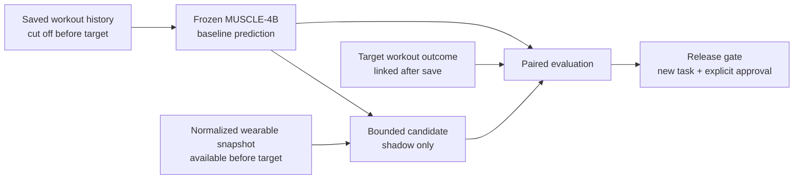

# WEARABLE-0 — Recovery Validation & Shadow Mode Data Contract

**Status:** CONTRACT COMPLETE — implementation-ready research architecture, **not** a production
wearable feature. Health Connect is not implemented; no wearable signal affects readiness or advice.

**Audit boundary:** documentation only. MUSCLE-4B, Muscle Heat, Progressive Overload, Room schema,
UI, import/export behavior, and production recommendations remain unchanged.

**Backup before documentation edits:**
`D:\HOCTIN\GYM TRACKER\_backup_wearable0_contract_20260713_112624`.

---

## 1. Executive decision

Do **not** start by wiring sleep/HRV/RHR into MUSCLE-4B. The first implementation must create an
immutable, leakage-safe validation record that freezes the visible MUSCLE-4B prediction before a
target workout and links it to the workout outcome after save.

The approved research architecture is:



Hard decisions:

- MUSCLE-4B is the frozen physiological prior and visible production output.
- Workout log + catalog taxonomy + sets + RIR remain the muscle-specific stimulus source.
- Sleep/HRV/RHR are candidate recovery-environment context, not measured muscle damage.
- Workout HR is deferred; if studied later, it is acute/systemic context, not structural burden.
- Candidate output is hidden, cannot alter UI/advice/PO, and falls back **exactly** to baseline when
  data is missing, implausible, late, or low-confidence.
- The candidate can only be promoted by a separate, explicit task after out-of-sample improvement.

## 2. Current code and data lineage

Verified current path:

```text
LogWorkoutViewModel.saveWorkout
  -> GymRepository.saveWorkoutSession
  -> WorkoutSessionEntity + LoggedSetEntity
  -> HomeViewModel.observeSessionHistory
  -> MuscleRecoveryUseCase / MuscleRecoveryPipeline
  -> MuscleExposureCalculator
  -> MuscleHeatEngine
  -> MuscleRecoveryEngine (MUSCLE-4B)
  -> HomeViewModel.buildRecoveryUiState
  -> visible Home readiness
```

Evidence-backed map:

- `LogWorkoutViewModel.kt:309-347` builds completed inputs, saves, receives `sessionId`, then clears the
  draft and auto-advances. `buildInputs()` at `:556-570` persists only valid sets and resolves
  `canonicalExerciseKey`.
- `GymRepository.kt:289-342` inserts the session and its sets. Load, reps, RIR, duration, distance,
  set order, PR flags, plan `exerciseId`, name snapshot, and canonical key are persisted.
- `HomeViewModel.kt:287-298` observes session history and plan, samples `System.currentTimeMillis()`,
  and invokes `MuscleRecoveryUseCase`.
- `MuscleRecovery.kt:429-477` groups each saved session by canonical key, rejoins current catalog
  anatomy/tracking metadata, computes Layer-A exposure, then Layer-B heat. The heat
  `finalIntensityScore` is the MUSCLE-4B seed.
- `MuscleExposure.kt:103-160` counts tracking-valid sets as primary `1.0` and secondary `0.5`
  set-equivalents. Complete/partial/skipped are runtime concepts.
- `MuscleHeatEngine.kt:77-99` turns raw exposure into RIR/tracking-aware stimulus.
- `MuscleRecovery.kt:263-323` applies the frozen bi-exponential decay; `:479-540` creates muscle,
  group, overall, overlap, and neglect output.
- `HomeViewModel.kt:300-356` maps that baseline snapshot into the current visible UI.

The single-session Review path is separate: `SessionMuscleHeatUseCase.forSession()` at
`SessionMuscleHeatUseCase.kt:36-77`. It uses the **current** plan to infer targets/skips, so it is not a
historically frozen outcome contract.

## 3. Critique of the supplied wearable analysis

### Correct and retained

- A hybrid structure is more defensible than inferring muscle recovery directly from a smartwatch.
- HR does not identify which muscle is structurally burdened.
- Sleep/HRV/RHR can be treated as systemic context and compared with the user's own baseline.
- Missing/low-confidence data must abstain and preserve MUSCLE-4B.
- Wearable candidates need shadow-mode evaluation against later performance.

### Incomplete or overstated

- The supplied flowchart lacks prediction timestamps, an input cutoff, immutable prediction IDs,
  outcome linkage, missing-data reasons, model versions, and release gates. Without them it permits
  label leakage and post-hoc recomputation.
- The 2026 AI/wearables scoping review is broad evidence about sensing/classification/fatigue proxies;
  it does **not** validate muscle-level recovery or this exact AURON architecture.
- “Knowledge-embedded” is a reasonable engineering direction, not proof that a particular modifier or
  coefficient is physiologically correct.
- Sleep/HRV/RHR cannot be allowed to modify any production value until the candidate definition,
  bounds, and evaluation plan are preregistered and versioned.
- Vendor scores are derived products with changing and non-equivalent algorithms. They are not a
  portable data contract or ground truth.

## 4. Verified evidence versus assumptions and hypotheses

### Verified evidence

| Claim | Finding |
|---|---|
| Health Connect exposes needed records | Official Android documentation lists `SleepSessionRecord`, `HeartRateVariabilityRmssdRecord`, `RestingHeartRateRecord`, and series `HeartRateRecord`, each with separate read permissions. [Android data types](https://developer.android.com/health-and-fitness/health-connect/data-types) |
| Sleep and granular vitals are time-aligned, not session-ID joined | Android documents querying associated HR by the sleep session interval; a sleep session is complete only after its end. [Android sleep experience](https://developer.android.com/health-and-fitness/health-connect/experiences/sleep) |
| Provenance must be visible | Android requires attribution from `DataOrigin.packageName` and user access controls. [Data attribution](https://developer.android.com/health-and-fitness/health-connect/ui/data), [permissions and access](https://developer.android.com/health-and-fitness/health-connect/ui/permissions) |
| HRV, performance, and soreness can recover differently | In a small intense-RT study (`n=10`), LnRMSSD was back by 24 h, neuromuscular markers by 48 h, while perceptual recovery remained suppressed; the authors warn against inferring one metric from another. [Flatt et al., 2019](https://pmc.ncbi.nlm.nih.gov/articles/PMC6835520/) |
| Wrist HR is weaker in resistance training | A 44-study meta-analysis found larger wrist-PPG error during resistance training (mean bias about `-7.26 bpm`) and error increasing with HR. [Zhang et al., 2020](https://pubmed.ncbi.nlm.nih.gov/32552580/) |
| Consumer sleep metrics are device-variable | A meta-analysis found significant differences and high heterogeneity for sleep duration/efficiency/wake metrics; direct PSG comparisons find sleep/wake more credible than inconsistent sleep stages. [Lee et al., 2025](https://pmc.ncbi.nlm.nih.gov/articles/PMC11874098/), [Chinoy et al., 2021](https://academic.oup.com/sleep/article/44/5/zsaa291/6055610) |
| Sleep loss can affect performance, but does not supply an AURON coefficient | Modern systematic reviews report performance/strength effects with heterogeneous protocols and responses. [Easow et al., 2025](https://pubmed.ncbi.nlm.nih.gov/40663194/), [Kong et al., 2025](https://pubmed.ncbi.nlm.nih.gov/40236824/) |
| Wearable+AI strength evidence is not recovery validation | The 2026 scoping review includes 13 heterogeneous studies and reports small/homogeneous samples, proxy outcomes, and mostly internal validation. [Fyntikakis et al., 2026](https://www.mdpi.com/2076-3417/16/7/3565) |

### Reasonable engineering assumptions — not scientific facts

- A 28-valid-day personal baseline, 14-day provisional threshold, median/MAD normalization, 12-month
  retention, readiness-to-exercise mapping, and numeric release gates below are governance choices.
- The current PO proxy (`load × average working-set reps`, bodyweight = reps) can seed an operational
  performance label, but it is not a direct biological recovery measurement.
- The most-limited primary muscle is a conservative exercise-level readiness feature, not established
  ground truth.

### Unresolved hypotheses to test

- Normalized sleep duration/efficiency/awake time improves prediction beyond MUSCLE-4B.
- HRV/RHR deviation adds independent signal after sleep and workout history.
- A bounded systemic modifier improves the next comparable exercise outcome without increasing false
  “ready” calls.
- The effect is stable across users, sources, device changes, and partial-data nights.

No candidate coefficient or modifier direction is approved by WEARABLE-0.

## 5. Operational ground truth

Recovery has no single direct label. AURON should predict **future performance availability**, not
claim measured tissue recovery.

### Target event

The target is the workout instance opened after a prediction is frozen. Each catalog-mapped exercise
in that instance becomes a separate evaluation target. The saved session is attached only after the
save returns its `sessionId`.

### Primary outcome

For rep-based work, use a versioned **first-working-set performance delta**:

```text
loadedPerformance = mainWorkingLoad × firstWorkingSetReps
bodyweightPerformance = firstWorkingSetReps
delta = (actualPerformance / preWorkoutReferencePerformance) - 1
```

- Main working load uses the existing modal-load rule; the first set at that load by `setNumber` is the
  first working set. This is a heuristic because warm-up/working-set flags do not exist.
- The reference is snapshotted before the target from the most recent comparable exercise session.
- Tracking type, bodyweight/loaded class, canonical key, and exercise setup must match. Equipment/setup
  identity is unavailable today, so suspected changes are excluded or flagged, not silently compared.
- `materialPerformanceDrop = delta <= -0.10` is a proposed governance threshold, not a biological
  constant. Sensitivity analyses must also report `-0.05` and `-0.15` without changing the primary gate.

### Secondary outcomes

- actual main load vs frozen suggested load;
- first-set reps vs snapshotted target minimum;
- achieved RIR (kept separate; no structured suggested-RIR field currently exists);
- unexpected need to lower load from suggestion/reference;
- completed valid sets / snapshotted target sets;
- all working sets reaching the rep floor;
- runtime `SessionQuality` recomputed with a versioned evaluator;
- optional pre-workout soreness `0..10`, illness, injury, equipment-change, and deliberate-deload flags.

`CoachInsight`, `PlateauStrategy`, subjective post-session readiness, PR flags, and soreness are context
or secondary labels, not ground truth by themselves. Non-rep exercises must be evaluated separately
through their current metric comparability contract; they must not be forced into load×reps.

## 6. Connecting muscle readiness to exercise performance

Do not evaluate one global Home score against a whole workout.

At prediction time, snapshot each target exercise's canonical key, tracking type, catalog version,
primary muscles, secondary muscles, and plan targets. For baseline and candidate, derive the same
exercise features:

- `primaryReadinessMin`: minimum predicted readiness among primary muscles — preregistered primary
  feature, aligned with the current conservative “most fatigued member” roll-up.
- `primaryReadinessMean`: sensitivity feature.
- `secondaryReadinessMin`: context only; never allowed to override missing primary mapping.
- `overallReadiness`: descriptive only, never the exercise ground-truth predictor.

Custom/unmatched exercises and empty-primary mappings remain in outcome storage but are excluded from
muscle-level accuracy with `NO_PRIMARY_MUSCLE_MAPPING`. Muscle-level evaluation aggregates only outcomes
where that muscle was snapshotted as primary; secondary attribution is a separately reported analysis.

## 7. Proposed data contracts

All records are immutable events except explicit lifecycle state (consent/revocation/deletion). IDs are
random UUID strings; timestamps are UTC epoch milliseconds plus source zone offsets where available.

### Common identity

- `localResearchSubjectId`: app-generated random UUID; not an Android/device/account ID.
- `targetWorkoutInstanceId`: created when Log opens, persisted across draft recovery, and later bound to
  the saved `sessionId`.
- `predictionPairId`: joins baseline and candidate generated from the same cutoff.
- `canonicalExerciseKey`: cross-day exercise identity; never use plan `exerciseId` as the analytics key.
- `catalogContentVersion`, `planDayId`, `planExerciseId`, and target snapshots preserve reproducibility.

### Contract records

| Concept | Required fields |
|---|---|
| `BaselineRecoveryPrediction` | `predictionId`, `predictionPairId`, subject/target IDs, `predictionGeneratedAt`, `inputDataCutoffAt`, target-start deadline, `modelId=MUSCLE_4B`, model/version/hash, catalog version, input session IDs/digest, plan + muscle mapping snapshot, per-muscle readiness/fatigue/acute/structural/status, exercise-level features, overall output (descriptive), data confidence |
| `WearableContextSnapshot` | `snapshotId`, subject ID, `observedAt`, `inputDataCutoffAt`, sleep interval/durations/efficiency/coverage, HRV RMSSD + lnRMSSD + count/window, RHR + count/window, trailing-baseline stats/deviations, source app/device metadata, source-record digest, zone offsets, completeness, confidence, missing/invalid reasons |
| `CandidateRecoveryPrediction` | baseline/pair/context IDs, `candidateModelId/version/configDigest`, generated/cutoff times, per-muscle score and delta, exercise features, modifier bound used, `fallbackToBaseline`, fallback reasons, `affectsProduction=false` |
| `TargetWorkoutOutcome` | outcome/subject/target IDs, saved `sessionId`, actual Log-start and save/end timestamps, first-set-edit timestamp, day snapshot, completion state, subjective readiness, confounder flags, data completeness |
| `TargetExerciseOutcome` | outcome ID, canonical key + plan/catalog/mapping snapshot, planned targets, frozen PO action/suggested load/structured targets, actual ordered sets or references to saved set IDs, first working set, main load, achieved reps/RIR, completed/partial ratio, session quality, metric outcome, performance reference/delta, comparability/exclusion reason |
| `PredictionEvaluation` | baseline/candidate/outcome IDs, `evaluatorVersion`, evaluated-at time, eligibility/reason, primary/secondary readiness features, actual delta/drop labels, baseline/candidate calibrated risk/loss, band/calibration fields, missingness stratum |
| `DataConfidence` | `NONE/LOW/MODERATE/HIGH`, signal coverage, valid-day counts, source continuity, plausibility result, sorted reason codes, policy version |
| `ResearchConsentState` | subject ID, consent-contract version, state, granted/revoked timestamps, granted data scopes, retention setting, last deletion timestamp; consent never inferred from Health Connect permission alone |

The model version must be a semantic ID plus a code/config digest. A string such as
`MUSCLE_4B@1+sha256:<hash>` is preferable to the human label alone.

## 8. Prediction and outcome timing rules

1. At fresh Log/draft creation, generate `targetWorkoutInstanceId` and `targetStartedAt` **before any
   set edit**.
2. Read only workout records saved before `inputDataCutoffAt`.
3. Read only wearable records whose physiological interval ends on/before cutoff **and** that were
   actually observed by AURON by `predictionGeneratedAt`. Later sync must not rewrite history.
4. Compute baseline and candidate from the same frozen input cutoff and persist both atomically.
5. Prediction rows are immutable. New pre-workout data creates a new pair and marks the old pair
   superseded; it does not overwrite it.
6. The evaluation selects the latest valid pair generated before `targetStartedAt` and before
   `firstSetEditedAt`. A late prediction is excluded as `LATE_AFTER_TARGET_START`.
7. The target session and its sets are linked only after `saveWorkoutSession()` returns. Target outcome
   data can never enter its own prediction.
8. Discarded/abandoned targets are stored as `ABANDONED`/`NO_OUTCOME`, never matched opportunistically
   to a later session.
9. Store timezone/offset and sync/observed time; DST/travel cannot be inferred safely from local dates.

Current `WorkoutSessionEntity.startedAtMillis` is assigned inside repository save
(`GymRepository.kt:297-304`) and is therefore effectively save time. It must **not** be used as the
scientific workout-start boundary. The draft's Log-start time is closer but also needs an immutable
research contract.

## 9. Normalized wearable context

V1 stores daily/session-level aggregates, not vendor scores and not copied raw streams.

| Signal | Normalized fields | Notes |
|---|---|---|
| Sleep | start/end, zone offsets, time in bed, total asleep, awake duration, efficiency, stage-coverage fraction, awakenings/fragment count, selected-source rule | Efficiency is valid only with adequate stage/sleep-wake coverage. Deep/REM are optional exploratory fields and cannot drive V1. |
| HRV | RMSSD ms, lnRMSSD, sample count, aggregation method, start/end window, median and dispersion | Keep source-specific; never treat cross-device RMSSD as automatically interchangeable. |
| Resting HR | bpm, sample count, aggregation method/window, median and dispersion | Use deviation from the same-source personal baseline. |
| Personal baseline | prior-window start/end, valid-day count, median, MAD/IQR, absolute and robust-normalized deviation | Current day/night is excluded from its own baseline. |
| Provenance | `DataOrigin.packageName`, app label when displayable, Health Connect record/client ID digest, device manufacturer/model/type when present, recording method, observed-at | Needed for deduplication, source changes, audit, and user attribution. |

Do not store raw high-frequency HR in V1: it adds volume/privacy cost without validating muscle damage.
If workout HR is studied later, first store only versioned aggregates such as active-interval average,
peak, coverage, and 1/2-minute recovery where measurement timing is reliable.

## 10. Explicit V1 exclusions

- proprietary sleep/readiness/body-battery/recovery scores;
- cross-vendor score equivalence;
- Deep/REM as a strong modifier;
- SpO₂ for ordinary healthy-user recovery modeling;
- calories burned or energy-expenditure estimates;
- HR as direct structural muscle damage or as a muscle-local signal;
- raw high-frequency HR storage;
- unconstrained ML/deep learning or a black-box recovery score;
- rewriting historical workout stimulus, taxonomy, `A`, `B`, or MUSCLE-4B half-lives;
- silently activating a modifier after an app update.

## 11. Confidence and missing-data policy

Confidence is a gate, not a cosmetic label.

| Condition | Confidence/action |
|---|---|
| No research consent, required permission revoked, no eligible pre-cutoff data, implausible time/value, or late sync | `NONE`; no candidate input; exact baseline |
| Fewer than 14 valid same-source baseline days, unresolved overlapping sources, fragmented/incomplete sleep, insufficient HRV/RHR record coverage, or recent source change | `LOW`; candidate row may record abstention, output must equal baseline |
| 14–27 valid same-source days and one usable recovery signal with acceptable provenance/coverage | `MODERATE`; shadow candidate may compute, never production |
| At least 28 valid same-source days, usable sleep plus HRV or RHR, stable source, plausible values, and complete timing | `HIGH`; shadow candidate may compute, never production |

Mandatory reason codes include `NO_CONSENT`, `NO_PERMISSION`, `NO_SLEEP`, `WATCH_NOT_WORN`,
`FRAGMENTED_SLEEP`, `OVERLAPPING_SOURCES`, `INSUFFICIENT_HRV`, `INSUFFICIENT_RHR`,
`INSUFFICIENT_PERSONAL_BASELINE`, `SOURCE_CHANGED`, `IMPLAUSIBLE_VALUE`, `AFTER_CUTOFF`,
`LATE_PREDICTION`, `INCOMPLETE_OUTCOME`, `SETUP_CHANGED`, and `NO_PRIMARY_MUSCLE_MAPPING`.

Implementation invariants:

- `confidence < MODERATE` ⇒ every candidate muscle score equals baseline, delta is `0`, and
  `fallbackToBaseline=true`.
- Untrained muscles cannot receive new fatigue from a bad night. Systemic context may only adjust an
  existing active recovery burden.
- Multiple sleep records are deduplicated by source/record identity and interval. Conflicting sources
  are not averaged blindly.
- A source/device change creates a new calibration segment; the old baseline is retained for audit but
  not mixed into the new source's deviation.
- Health Connect's legal record ranges are necessary but not sufficient physiological plausibility
  checks. Plausibility policy must be versioned and covered by tests.

The 14/28-day gates are engineering choices that must be reviewed after pilot missingness is measured.

## 12. Personal calibration strategy

1. **Observation-only warm-up:** collect at least 28 valid nights before `HIGH` confidence. Candidate
   remains hidden regardless.
2. **Robust daily baseline:** prior 28 valid same-source days, excluding the current observation; use
   median + MAD (IQR fallback when MAD is zero), and store the window used.
3. **No population BPM/RMSSD cutoff:** store raw normalized values and within-person deviations.
4. **Source segmentation:** after device/source change, autonomic signals need 14 new valid days for
   provisional and 28 for high confidence. Do not splice vendor series as if identical.
5. **Outcome calibration:** begin with fixed global candidate logic. Do not fit per-user coefficients
   until at least 20 comparable exercise outcomes; do not fit per-muscle coefficients without at least
   30 outcomes for that muscle. These are anti-overfitting governance thresholds, not power analysis.
6. **Rolling-origin evaluation:** all calibration data must precede each evaluated target. No random
   split that trains on future sessions.
7. **Version freeze:** changing features, bounds, baseline window, or coefficients creates a new model
   version and a new evaluation cohort; never revise old predictions.

An initial single-user pilot should target roughly 30 valid nights and 20–30 workout sessions to expose
data-quality bugs. It cannot justify general product activation.

## 13. Shadow-mode behavior

- Production reads and renders only `BaselineRecoveryPrediction` / current MUSCLE-4B.
- Candidate is written only to research tables and has `affectsProduction=false` as a tested invariant.
- Candidate cannot change Home readiness, plan-overlap nudges, workout selection, PO action, weight,
  confidence, wording, notifications, or training advice.
- Missing/low-confidence context produces an explicit exact-baseline candidate, not a guessed value.
- Outcome attachment and evaluation happen after save; no evaluation result feeds the same target.
- Candidate explanations are research diagnostics, not user-facing health claims.
- Promotion requires a new code path, feature flag, explicit consent text, rollback path, and a separate
  task after release-gate review. There is no automatic threshold that can silently turn it on.

## 14. Evaluation metrics

All comparisons are paired: baseline and candidate predict the same exercise outcome from the same
cutoff.

### Primary metric

`materialPerformanceDrop` is the preregistered binary target. On rolling time splits, fit the same
simple monotonic calibration from readiness score to drop probability for baseline and candidate using
past data only. Compare out-of-sample **Brier score** per matched exercise outcome. Report paired
bootstrap confidence intervals clustered by user/session.

### Secondary metrics

- first-working-set performance-delta MAE after the same past-only calibration;
- AUROC and precision-recall for material drop (descriptive when event count is small);
- Spearman association between readiness and performance delta;
- observed drop rate and calibration error within readiness bands;
- **false ready:** prediction `>=88` while a material drop occurs;
- **false not-ready:** prediction `<72` while performance is stable/improved;
- suggestion/rep-floor/set-completion attainment;
- day-to-day stability and maximum change without any new input event;
- abstention/fallback coverage;
- performance under missing sleep, missing HRV, missing RHR, partial nights, and source changes;
- results stratified by tracking type, canonical exercise, primary muscle, source/device, and user.

Do not pool incomparable metric exercises with rep-based outcomes. Do not report accuracy from targets
used to tune the candidate.

## 15. Release gates

These are conservative **product governance gates**, not a scientific sample-size calculation. A power
analysis should replace the cohort-size floor after pilot event rates/variance are known.

Candidate may be considered for a limited opt-in beta only when all are true:

1. At least 8 weeks, 30 consenting users, and 300 eligible paired exercise outcomes; preferred evidence
   is 50 users / 500 outcomes.
2. Primary out-of-sample Brier score improves by at least 5% relative to MUSCLE-4B and the clustered
   95% bootstrap CI excludes no improvement.
3. False-ready rate is not worse: upper 95% CI of candidate-minus-baseline is `<= +1` percentage point.
4. No adequately represented source/device or major user stratum shows material degradation; sparse
   strata remain shadow-only.
5. Exact fallback is 100% in all `NONE/LOW` and permission-revoked tests.
6. With no new workout/wearable input, repeated computation is byte-equivalent; no unexplained score
   oscillation.
7. Missing-data/source-change tests, migrations, deletion, consent, process-death, and export exclusion
   are green.
8. The candidate has a fixed version/config digest, documented bound, rollback, and an explicit manual
   activation task. Passing metrics alone cannot activate it.

Per-user influence would additionally require that user's 28 valid baseline nights and at least 8
evaluable sessions/12 exercise outcomes. Until then, that user stays on exact MUSCLE-4B.

## 16. Privacy, consent, retention, and export

- Explicit opt-in is separate from Android permission. Default state is `NOT_CONSENTED`.
- Local-first only; no Firebase, account, cloud sync, or backend is required for the research phase.
- Show connected source apps and provide Health Connect permission management. Turning sync off stops
  reads immediately.
- “Delete recovery research data” deletes normalized wearable snapshots, predictions, outcomes,
  evaluations, source metadata, and the local research subject ID with foreign-key cascades. It does
  not delete normal workout history unless the user separately requests that.
- Proposed default retention: 12 rolling months for linked research records; unlinked predictions and
  abandoned targets purge after 30 days. These are reviewable product-policy assumptions.
- Do not copy raw high-frequency sensor streams into AURON.
- Existing plan/history JSON export (`schemaVersion 5`) must exclude research/health data by default.
  If a research export is later needed, it must be a separate, explicit, clearly labeled export with
  its own `researchSchemaVersion`; importing it must never restore consent or permissions.
- Consent state is not imported. Revocation stops collection; deletion remains a separate explicit and
  immediately available action.

## 17. Recommended Room schema — proposal only

**Recommendation: future Room tables are required.** Predictions must survive process death, be
immutable, link transactionally to saved sessions, support paired queries, deletion cascades, model
versions, and leakage audits. SharedPreferences, in-memory state, or an ad-hoc JSON file cannot provide
that reliably.

Current Room version is `8`. Proposed WEARABLE-1A migration is additive `8 -> 9`, creating research
tables only; no columns are added to `workout_sessions` or `logged_sets`.

| Proposed table | Key columns / indexes |
|---|---|
| `recovery_research_consent` | `localResearchSubjectId PK`, state, contractVersion, scopes, grantedAt, revokedAt, retentionDays, deletedAt |
| `recovery_wearable_contexts` | `snapshotId PK`, subject FK, observedAt, cutoffAt, normalized sleep/HRV/RHR/baseline fields, confidence, reasonCodes, policyVersion; indexes `(subjectId, cutoffAt)`, `(confidence, cutoffAt)` |
| `recovery_wearable_sources` | composite PK `(snapshotId, sourceOrdinal)`, source package/app/device/recording metadata and record digest; FK cascade to context |
| `recovery_predictions` | `predictionId PK`, pairId, kind `BASELINE/CANDIDATE`, subject/target/context/baseline FKs, generatedAt, cutoffAt, targetDeadlineAt, model/version/config digest, catalogVersion, inputDigest, overall output, confidence, fallback, affectsProduction; indexes `(targetInstanceId, kind, generatedAt)`, `(pairId)`, `(modelId, modelVersion)` |
| `recovery_prediction_muscles` | composite PK `(predictionId, muscleGroup)`, readiness, fatigue, acute, structural, status, delta; indexes `(muscleGroup, predictionId)` |
| `recovery_workout_outcomes` | `outcomeId PK`, subject/target IDs, `sessionId UNIQUE`, targetStartedAt, firstSetEditedAt, savedAt, completion/confounder/confidence fields; unique index `targetInstanceId` |
| `recovery_exercise_outcomes` | `exerciseOutcomeId PK`, outcome FK, canonical key, plan/catalog/muscle/target/suggestion snapshots, first-working-set/main-load/actual/set-completion/session-quality/metric/delta/comparability fields; index `(canonicalExerciseKey, outcomeId)` |
| `recovery_prediction_evaluations` | `evaluationId PK`, baseline/candidate/exercise-outcome FKs, evaluatorVersion, eligibility/reason, prediction features, actual labels, paired losses/band/missingness fields; unique index on the prediction pair + outcome + evaluator version |

Foreign keys use `ON DELETE CASCADE` inside the research graph. `sessionId` is a linkage value but
normal workout deletion must mark/delete the dependent research outcome in one transaction. Exported
Room schema JSON and migration tests are mandatory.

Alternatives considered:

- **SharedPreferences:** suitable for a simple toggle, not consent history or event data.
- **JSONL/file:** easy prototype, but weak atomicity, indexing, FK integrity, deletion, and process-death
  linkage; rejected for implementation.
- **Separate SQLite database:** stronger physical separation but duplicates migrations/transactions and
  complicates binding to saved sessions. Reconsider only if a later privacy review requires it.

## 18. Exact staged implementation sequence

1. **WEARABLE-1A — Recovery Research Foundation + Frozen Baseline/Outcome Capture.** Add opt-in consent,
   additive research tables/migration, target-workout instance lifecycle, immutable MUSCLE-4B prediction
   capture before set edits, post-save outcome linkage, deletion/export exclusion, and contract tests.
   No Health Connect and no candidate modifier.
2. **WEARABLE-1B — Health Connect Read-Only Normalization.** Read sleep, HRV RMSSD, and resting HR with
   provenance; normalize/deduplicate; compute confidence and same-source personal baselines. Still no
   candidate effect.
3. **WEARABLE-1C — Bounded Candidate Shadow Model.** Define and preregister one candidate version,
   bound, fallback, and invariants outside the frozen engines; persist hidden paired output.
4. **WEARABLE-1D — Outcome Evaluator + Research Export.** Build leakage-safe linkage, versioned metrics,
   rolling-origin evaluation, and a separate explicit research export if needed.
5. **WEARABLE-2 — Limited Opt-In Influence Review.** Only after release gates; separate approval,
   feature flag, UI disclosure, rollback, and runtime QA.

### Exact next task

**WEARABLE-1A — Recovery Research Foundation + Frozen Baseline/Outcome Capture** is the next task.
Its acceptance boundary is: Room `v8 -> v9` research tables, consent off by default, prediction frozen
before the first set edit, outcome linked after save, no Health Connect, no candidate, and zero changes
to visible readiness/advice or the three frozen engines.

## 19. Subagent findings, test result, and freeze proof

Exactly one read-only subagent audited recovery, heat, progression, save, outcome, identity, and export
lineage. It changed no files and ran no build.

Distilled verified findings:

- Achieved set metrics and canonical identity exist, but the displayed pre-workout suggestion is not
  persisted or linked to the eventual session.
- `SessionQuality`, `CoachInsight`, `PlateauStrategy`, and numeric confidence are runtime-only; the Log
  UI calls reduced `suggestion()` and discards those typed values.
- First working set is reconstructable by set order + modal load, but is not explicit.
- Incomplete/abandoned draft rows are not durable outcomes.
- Plan targets, anatomy, taxonomy, and goal context are not historically snapshotted.
- `startedAtMillis` is save time; there is no end timestamp, per-set timestamp, timezone, sync time, or
  wearable provenance.
- The comment at `MuscleHeatEngine.kt:102-106` says `ExerciseContributor` reserves PO metadata, but the
  actual type at `MuscleExposure.kt:44-60` has no such fields. Future work must not rely on that stale
  comment.
- No standalone PO report exists in `docs`; the versioned README through V3.11D is the current PO and
  session-quality record.

### Unit test result

`./gradlew.bat :app:testDebugUnitTest --console=plain` completed with exit code `0` in `101.1 s`.
The generated JUnit XML contains **20 suites, 339 tests, 0 failures, 0 errors, and 0 skipped**.

### Baseline SHA-256 freeze proof

| Frozen file | Before audit | After audit |
|---|---|---|
| `MuscleRecovery.kt` | `0520CE83248BE1A5F9431E97981E12F75ECBA77F9262355644B0D8E2F8DBF748` | `0520CE83248BE1A5F9431E97981E12F75ECBA77F9262355644B0D8E2F8DBF748` |
| `MuscleHeatEngine.kt` | `12804F8654BA8124B2200BFB1066360FA70D5A82058C948FAA3F8DE1EB065341` | `12804F8654BA8124B2200BFB1066360FA70D5A82058C948FAA3F8DE1EB065341` |
| `ProgressiveOverload.kt` | `8D2355D55980B647CE327C7FF790718007FC97360A092886CE6EF5C88CBB957B` | `8D2355D55980B647CE327C7FF790718007FC97360A092886CE6EF5C88CBB957B` |

---

## Stop boundary

WEARABLE-0 ends with this contract. It does not implement WEARABLE-1A, Health Connect, wearable data
collection, a candidate formula, Room `v9`, UI, backend, or production activation.
